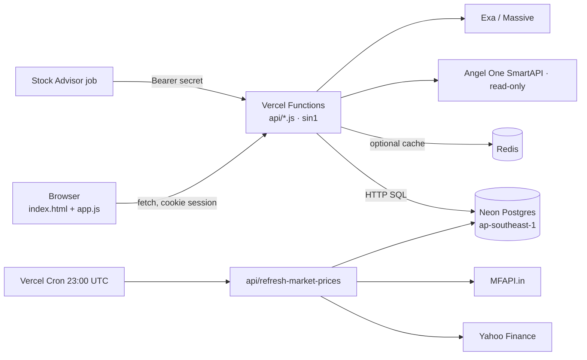
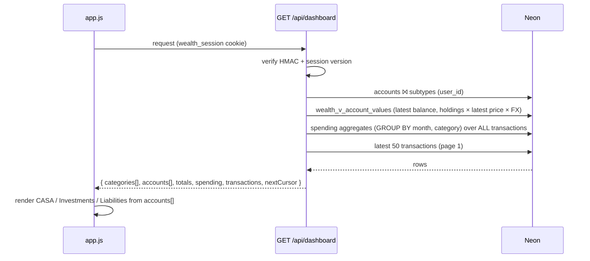
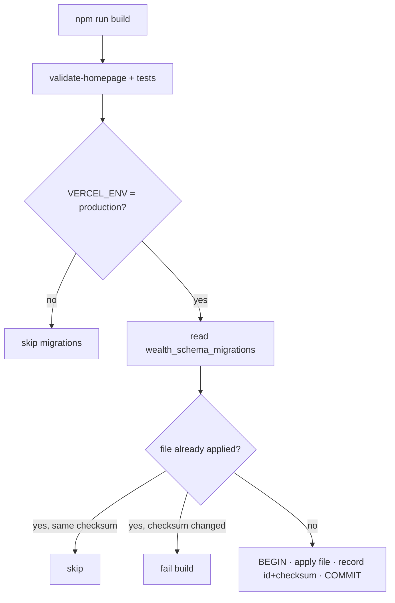
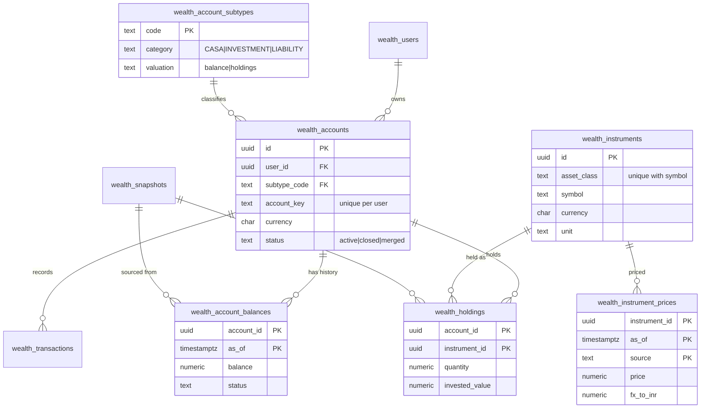

# Technical Specification Document (TSD) — Claude Plan 1

**Wealth Ledger — Stabilisation, Security and Account Hierarchy Data Model**

## 0. Document control

| Field | Value |
|---|---|
| Document | TSD — Claude Plan 1 |
| Project | Wealth Ledger (`akashkarthi11/wealth`), Vercel project `wealth` |
| Version | 1.2 |
| Date | 2026-11-10 |
| Author | Claude (Claude Code), prepared for the project owner |
| Status | **Implemented on `claude-dev`** (see §19). Not deployed; no Neon database changed. Awaiting a Neon-branch run and approvals |
| Companion PSD / FSD | Not yet created. This TSD covers technical changes only; no new business functionality is introduced |
| Format note | **Assumption:** no existing GrowX TSD template was found in the repository or workspace, so this follows a standard TSD structure. Re-format if a GrowX template exists |

### Revision history

| Version | Date | Change |
|---|---|---|
| 1.0 | 2026-11-10 | First draft from a full read of code, docs and the Preview Neon database |
| 1.1 | 2026-11-10 | Implementation status added (§19); OpenAPI unchanged except `/api/auth` uses `action=reset` |
| 1.2 | 2026-11-10 | Owner rule: no data deletion. TR-6.4/6.5/6.6 withdrawn; repair made non-destructive; runner guard added |

### Approvals

| Role | Name | Decision | Date |
|---|---|---|---|
| Project owner | _pending_ | | |
| Reviewer | _pending_ | | |

Per [Wealth Reliability & Data Integrity](../WEALTH_RELIABILITY_AND_DATA_INTEGRITY.md), every deployment and every database write needs explicit owner approval for that specific target.

---

## 1. Introduction

### 1.1 Purpose

Specify the technical changes required to:

1. close security gaps in authentication;
2. stop deployments from changing financial data;
3. fix confirmed calculation and UI defects;
4. remove duplicated data and enforce primary/foreign keys;
5. move to the data shape **user → account (CASA | INVESTMENT | LIABILITY) → subtype → data**.

### 1.2 Scope

| In scope | Out of scope |
|---|---|
| `api/*`, `app.js`, `index.html`, `scripts/*`, Neon schema and data, `package.json`, CI | New product features, UI redesign, new data providers, mobile apps |

### 1.3 References

| Document | Purpose |
|---|---|
| [docs/index.md](../index.md) | Fix index and documentation rules |
| [Module reference](../modules/) | Per-module files, APIs, tables, known issues |
| [Database optimization plan](2026-11-10-database-optimization-plan.md) | Size, query and retention findings |
| [Data normalization design](2026-11-10-data-normalization-design.md) | Measured duplication; key stages 1–2 |
| [Account hierarchy model](2026-11-10-account-hierarchy-model.md) | Target data model and sample |
| [`scripts/db/schema.sql`](../../scripts/db/schema.sql) | Baseline schema generated from the live catalog |

### 1.4 Definitions

| Term | Meaning |
|---|---|
| CASA | Current and savings accounts (bank cash) |
| Subtype | Specific kind of account within a category, e.g. `savings`, `demat_equity`, `credit_card` |
| Instrument | A tradable or priced item shared by all users: stock, ETF, fund, metal |
| Holding | Quantity of one instrument inside one account |
| Balance | Cash value, deposit value, or amount owed, at a point in time |
| Aggregate row | A legacy position summarising several holdings (e.g. "Angel One equity portfolio aggregate") |
| Preview DB | Neon database behind the `development` branch's Vercel Preview deployment |

---

## 2. Current system

### 2.1 Architecture



| Layer | Technology |
|---|---|
| Frontend | Static HTML + vanilla JS (`app.js`, ~91 KB), no framework |
| API | Vercel serverless functions, Node 20+, ES modules |
| Database | Neon PostgreSQL 18, `@neondatabase/serverless` HTTP driver |
| Cache | Redis (optional; dashboard deliberately uncached) |
| Build | `validate-homepage.mjs` → tests → `migrate-db.mjs` (Production only) |

### 2.2 Data access pattern

There are **no DAO / repository classes**. Each handler in `api/` issues SQL directly through the shared `sql` client in `api/_lib.js`. This TSD keeps that pattern (see §11 for a proposed thin query module).

### 2.3 Confirmed defects (inputs to this TSD)

| ID | Defect | Evidence |
|---|---|---|
| DEF-01 | Password reset needs only email + shared access key | `api/auth.js:32-36` |
| DEF-02 | No server-side minimum password; no rate limit; no session revocation | `api/auth.js`, `api/_lib.js` |
| DEF-03 | Each Production deploy overwrites live Angel One prices with snapshot LTP marked `fresh` | `convert-angelone-equity-to-live-positions.sql:124-137` |
| DEF-04 | Each deploy resets mutual-fund scheme codes and pricing status | `investment-position-normalization.sql:329-333` |
| DEF-05 | Spending statistics use only the latest 500 of 594 transactions | `api/dashboard.js:34` (`LIMIT 500`) |
| DEF-06 | INDmoney buying power ₹941.18 shown as ₹0 (stored on archived row) | DB + `app.js:158` |
| DEF-07 | Credit-card balance stored 3 times with different values (₹30,634.21 / ₹30,536.95) | DB audit |
| DEF-08 | Active LIC and Slice auto-deposit mandates linked to cancelled obligations | DB audit query 5 |
| DEF-09 | Double-escaped regexes: FD maturity date always rejected; FD rows not filtered from bank cards; TOTP whitespace | `api/positions.js:16`, `app.js:223`, `api/angel.js:5` |
| DEF-10 | Chart tooltips never show; ledger entry form never shown | `app.js:278`, `index.html` |
| DEF-11 | All 26 prices hand-seeded and marked `fresh`; USD prices have no FX | DB audit |
| DEF-12 | Same facts stored 2–3 times across positions, assets, prices, accounts, obligations | [Normalization design](2026-11-10-data-normalization-design.md) |
| DEF-13 | No migration creates the core tables; DDL runs on every dashboard request | repo, `api/dashboard.js:52` |

---

## 3. Business flow (unchanged)

No business behaviour changes. The owner still: signs in → sees net worth (CASA + Investments − Liabilities) → expands categories → reviews holdings, transactions, interest, alerts and mandates. Prices refresh daily. Stock Advisor reports arrive by scheduled ingest.

## 4. System flow (target)

### 4.1 Dashboard read



### 4.2 Price refresh

```mermaid
sequenceDiagram
  participant Cron as Vercel Cron
  participant J as /api/refresh-market-prices
  participant P as Yahoo / MFAPI
  participant DB as Neon
  Cron->>J: Bearer CRON_SECRET
  J->>DB: SELECT instruments with price_source_symbol
  J->>P: USD/INR once, then one quote per instrument
  P-->>J: price, timestamp
  J->>DB: INSERT wealth_instrument_prices (instrument_id, as_of, source, price, fx_to_inr)
  Note over J,DB: once per instrument, not per user; failure inserts nothing (no fake "fresh")
```

### 4.3 Deploy-time migrations



---

## 5. Impacted components

| Component | Change | Phase |
|---|---|---|
| `api/auth.js` | Reset flow, password policy, rate limit, constant-time compare | 1 |
| `api/_lib.js` | Session version in token; rate-limit helper | 1 |
| `scripts/migrate-db.mjs` | Versioned, once-only, transactional runner | 2 |
| `scripts/migrations/*` | Renumbered; data repairs moved to `scripts/db/repairs/` | 2 |
| `api/dashboard.js` | No DDL; SQL aggregates; new response (v2) | 2, 3, 5 |
| `api/ledger.js` | Cursor pagination | 3 |
| `api/positions.js` | Regex fix; v2 creates FD account + balance | 3, 5 |
| `api/angel.js` | TOTP regex fix | 3 |
| `api/refresh-market-prices.js` | Write instrument prices with FX; no `fresh` on failure | 3, 5 |
| `api/planned-bills.js` | PATCH also updates the payment occurrence | 6 |
| `app.js`, `index.html` | Regex/tooltip/form fixes; render from accounts | 3, 5 |
| Neon schema | Keys, new hierarchy tables, views | 4, 5, 6 |
| `package.json`, CI | Test commands; workflow on PRs to `main` and `development` | 0, 5 |

---

## 6. Technical design by phase

Requirement IDs (`TR-x.y`) are referenced by tests in §12.

### Phase 0 — Safety net

| ID | Requirement |
|---|---|
| TR-0.1 | Determine whether the Preview DB host equals the Production DB host; record the answer here (host only) |
| TR-0.2 | Create a Neon branch of the Development database for all trials |
| TR-0.3 | `scripts/db/schema.sql` must rebuild an empty branch with no errors; catalog diff must be empty |
| TR-0.4 | All documentation and draft scripts committed on a feature branch, PR to `development` |

### Phase 1 — Authentication security

| ID | Requirement |
|---|---|
| TR-1.1 | Password reset must not succeed with only email + shared access key. **Decision D2** chooses: (a) owner-only reset from a signed-in admin session, or (b) emailed single-use token (hash stored, 30-min expiry). Default: (a) |
| TR-1.2 | Server rejects passwords shorter than 10 or longer than 200 characters on register and reset |
| TR-1.3 | Max 5 failed logins per email and 20 per IP per 15 minutes (Redis `INCR` + `EXPIRE`); exceeding returns `429` with `Retry-After`. If Redis is down: allow, and log |
| TR-1.4 | `wealth_users.session_version int NOT NULL DEFAULT 1`; token body includes `sv`; `userFrom` rejects a token whose `sv` differs; password reset increments it |
| TR-1.5 | Access key compared with `timingSafeEqual` on equal-length buffers |

### Phase 2 — Deterministic migrations

| ID | Requirement |
|---|---|
| TR-2.1 | Table `wealth_schema_migrations(id text PK, checksum text NOT NULL, applied_at timestamptz NOT NULL DEFAULT now())` |
| TR-2.2 | Files named `NNNN_description.sql`; `0000_baseline.sql` = `schema.sql`. Existing files recorded as applied on first run |
| TR-2.3 | Each file runs once inside one transaction using the Neon WebSocket `Pool`; SHA-256 checksum mismatch fails the build |
| TR-2.4 | Data repairs (seeded prices, archiving, hard-coded UUIDs) are removed from the deploy path and live in `scripts/db/repairs/`, run manually with approval |
| TR-2.5 | `api/dashboard.js` performs no DDL |

### Phase 3 — Correctness fixes

| ID | Requirement |
|---|---|
| TR-3.1 | Spending statistics (monthly totals, category totals, yearly averages, daily averages) computed in SQL over all of the user's expense transactions |
| TR-3.2 | Visible transaction list paginated: 50 per page, cursor `(occurred_on, created_at, id)` |
| TR-3.3 | Regex fixes: `/^\d{4}-\d{2}-\d{2}$/`; `/\b(?:fixed\s*deposits?|fds?|term\s*deposits?)\b/i`; `/=|\s/g` |
| TR-3.4 | Chart points carry `data-chart-point`; tooltip shows on click/tap and keyboard Enter |
| TR-3.5 | Ledger entry form reachable from the Transactions view (button "Add entry") |
| TR-3.6 | Price rows not produced by the refresh job have status `manual`; USD refresh stores `fx_to_inr` and `fx_as_of`; a failed quote never writes `fresh` |

### Phase 4 — Keys and duplicate clean-up

| ID | Requirement | Script |
|---|---|---|
| TR-4.1 | Composite owner FKs `(user_id, parent_id) → parent(user_id, id)` on 13 relations, added `NOT VALID` then validated | [stage 1](../../scripts/migrations/drafts/2026-11-10-normalization-stage1-keys.sql) |
| TR-4.2 | Unique: one active position per holding; one advisor report per `(user_id, run_at)`; `wealth_transactions.external_ref` unique per user when set | stage 1 |
| TR-4.3 | Drop 4 duplicate indexes and 13 redundant single-column FKs; remove their re-creation from `migrate-db.mjs` | stage 1 |
| TR-4.4 | Re-link LIC / Slice auto-deposit obligations to active mandates; one open interest rate per product; strip duplicated metadata keys; delete advisor snapshot copy | [stage 2](../../scripts/migrations/drafts/2026-11-10-normalization-stage2-data.sql) |
| TR-4.5 | `fixed-deposits` account row and the 5 identical transaction pairs handled per decisions D3, D4 | stage 2 (commented) |

### Phase 5 — Account hierarchy

| ID | Requirement |
|---|---|
| TR-5.1 | Apply [schema](../../scripts/migrations/drafts/2026-11-10-account-hierarchy-1-schema.sql) and [backfill](../../scripts/migrations/drafts/2026-11-10-account-hierarchy-2-backfill.sql); backfill aborts if any active holding or balance is not carried over |
| TR-5.2 | `wealth_v_account_values` totals must equal today's dashboard per category to the paisa, except differences listed and explained in the fix note |
| TR-5.3 | `/api/dashboard` v2 response (§8.2) built from accounts, balances, holdings, latest prices |
| TR-5.4 | Refresh job writes `wealth_instrument_prices` once per instrument |
| TR-5.5 | `app.js` renders categories and accounts from the v2 payload; removes aggregate fallbacks, archived-row lookups and metadata FX |
| TR-5.6 | `POST /api/positions` (FD) creates a `fixed_deposit` account + balance (v2 contract §8.4) |
| TR-5.7 | A USD holding without a positive `fx_to_inr` is returned with `valueInr: null` and `valuationStatus: "missing_fx"`, never converted with an invented rate |

### Phase 6 — Consolidation

| ID | Requirement |
|---|---|
| TR-6.1 | Single obligations table; mandate details in `wealth_mandates (obligation_id PK/FK)`; legacy bill/subscription tables exposed as views during transition |
| TR-6.2 | `PATCH /api/planned-bills` updates the matching payment occurrence in the same transaction |
| TR-6.3 | `wealth_interest_products` linked to accounts; ledger, statements, rates reference `product_id` |
| TR-6.4 | ~~Drop `wealth_transactions.account` text~~ — **withdrawn (v1.2): no data is deleted.** The column stays; the app reads the account through `account_id` |
| TR-6.5 | ~~Retention: delete old Stock Advisor reports~~ — **withdrawn (v1.2): no data is deleted** |
| TR-6.6 | ~~Drop legacy tables~~ — **withdrawn (v1.2): legacy tables are kept** read-only for audit; the app stops reading them after the v2 switch |

> **Data-retention rule (owner, v1.2): migrations and repairs never delete data.** No `DELETE`, `TRUNCATE`, `DROP TABLE/COLUMN/VIEW`. Superseded rows are marked (e.g. `status = 'merged'`) and overwritten values are kept in notes. Enforced by `scripts/db/migrations-lib.mjs` (the runner refuses destructive files) and `scripts/tests/no-data-deletion.test.mjs` (also checks every repair script).

---

## 7. Data design

### 7.1 Target entity relationship



### 7.2 Tables

| Table | Status | Key rule that prevents duplicates |
|---|---|---|
| `wealth_account_subtypes` | New (reference data) | PK `code` |
| `wealth_accounts` | Changed: `subtype_code`, `status` | Unique `(user_id, account_key)`; `user_id` stored only here |
| `wealth_account_balances` | New | PK `(account_id, as_of)` |
| `wealth_instruments` | New, shared | Unique `(asset_class, symbol)` |
| `wealth_instrument_prices` | New | PK `(instrument_id, as_of, source)`; latest price is a view |
| `wealth_holdings` | New | PK `(account_id, instrument_id)` |
| `wealth_transactions` | Changed: `external_ref` | Unique `(user_id, external_ref)` when set |
| `wealth_schema_migrations` | New | PK `id` |
| `wealth_users` | Changed: `session_version` | — |
| `wealth_positions`, `wealth_investment_assets`, `wealth_market_prices`, `wealth_price_history` | Legacy, read-only after Phase 5 | Dropped in Phase 6 with approval |

Views: `wealth_v_latest_prices`, `wealth_v_latest_balances`, `wealth_v_account_values`.

### 7.3 Subtype catalogue

| Category | Subtypes | Valued by |
|---|---|---|
| CASA | `savings`, `current` | balance |
| INVESTMENT | `demat_equity`, `mutual_fund`, `us_brokerage`, `digital_gold`, `digital_silver` | holdings (+ broker cash balance) |
| INVESTMENT | `fixed_deposit`, `provident_fund` | balance |
| LIABILITY | `credit_card`, `credit_line`, `loan` | balance (amount owed) |

**Assumption (D6):** fixed deposits stay under INVESTMENT, matching the current dashboard.

### 7.4 Valuation rules

| Item | Value in INR |
|---|---|
| CASA / FD / EPF / liability | Latest balance (account currency INR) |
| INR holding | quantity × latest price |
| USD holding | quantity × latest price × `fx_to_inr` of that price row; null if FX missing (TR-5.7) |
| Broker cash (USD) | balance × latest USD/INR; null if FX missing |
| Net worth | Σ CASA + Σ INVESTMENT − Σ LIABILITY; items with status `pending_reconciliation` or null value are reported separately, not silently added |

### 7.5 Migration and rollback

| Step | Forward | Rollback |
|---|---|---|
| Stage 1 keys | Additive constraints, `NOT VALID` → `VALIDATE` | Drop added constraints/indexes; re-create dropped ones from `schema.sql` |
| Stage 2 data | Scoped `UPDATE`/`DELETE` in one transaction | Restore from the Neon branch point taken before the run |
| Hierarchy schema | New tables/views, additive | Drop new objects; legacy tables untouched |
| Hierarchy backfill | Idempotent inserts with completeness check | Truncate new tables |
| API switch | Feature flag `WEALTH_DATA_MODEL=v2` | Set flag to `v1` |

---

## 8. API specification (OpenAPI 3.x, changed endpoints only)

Unchanged endpoints (`/api/angel`, `/api/providers`, `/api/snapshot`, `/api/stock-advisor`, `/api/clear-session`) are documented in the [module reference](../modules/).

```yaml
openapi: 3.0.3
info:
  title: Wealth Ledger API — changes in Claude Plan 1
  version: 2.0.0-draft
servers:
  - url: https://{deployment}.vercel.app
    variables: { deployment: { default: wealth } }
components:
  securitySchemes:
    session:
      type: apiKey
      in: cookie
      name: wealth_session
      description: HMAC-SHA256 signed {uid, exp, sv}; HttpOnly, Secure, SameSite=Lax, 7 days
    cronSecret:
      type: http
      scheme: bearer
      description: CRON_SECRET
  schemas:
    Error:
      type: object
      required: [error]
      properties:
        error: { type: string, example: "Sign in required" }
    Credentials:
      type: object
      required: [email, password]
      properties:
        email: { type: string, format: email, maxLength: 254 }
        password: { type: string, minLength: 10, maxLength: 200 }
        secretKey: { type: string, description: "Required for register only" }
    User:
      type: object
      properties:
        id: { type: string, format: uuid }
        email: { type: string, format: email }
        role: { type: string, enum: [user, admin] }
    Money:
      type: object
      required: [amount, currency]
      properties:
        amount: { type: number, nullable: true, description: "null when it cannot be valued (e.g. missing FX)" }
        currency: { type: string, enum: [INR, USD] }
    Holding:
      type: object
      properties:
        instrumentId: { type: string, format: uuid }
        symbol: { type: string, example: LT }
        name: { type: string }
        quantity: { type: number }
        unit: { type: string, enum: [share, unit, g] }
        price: { $ref: '#/components/schemas/Money' }
        priceAsOf: { type: string, format: date-time, nullable: true }
        priceSource: { type: string, nullable: true }
        value: { $ref: '#/components/schemas/Money' }
        valueInr: { type: number, nullable: true }
        invested: { $ref: '#/components/schemas/Money' }
        valuationStatus: { type: string, enum: [fresh, stale, manual, missing_price, missing_fx] }
    Account:
      type: object
      properties:
        id: { type: string, format: uuid }
        category: { type: string, enum: [CASA, INVESTMENT, LIABILITY] }
        subtype: { type: string, example: demat_equity }
        institution: { type: string, example: Angel One }
        name: { type: string }
        maskedIdentifier: { type: string, nullable: true }
        currency: { type: string, enum: [INR, USD] }
        balance: { $ref: '#/components/schemas/Money' }
        balanceAsOf: { type: string, format: date-time, nullable: true }
        balanceStatus: { type: string, enum: [verified, reported, pending_reconciliation], nullable: true }
        holdings: { type: array, items: { $ref: '#/components/schemas/Holding' } }
        valueInr: { type: number, nullable: true }
        stale: { type: boolean, description: "balance or any price older than 48 h" }
    Transaction:
      type: object
      properties:
        id: { type: string, format: uuid }
        kind: { type: string, enum: [income, expense, transfer, investment, liability] }
        category: { type: string, maxLength: 60 }
        description: { type: string, maxLength: 180 }
        amount: { type: number, exclusiveMinimum: true, minimum: 0, maximum: 1000000000000 }
        accountId: { type: string, format: uuid, nullable: true }
        account: { type: string, description: "Display name from wealth_accounts" }
        occurredOn: { type: string, format: date }
    SpendingSummary:
      type: object
      properties:
        months: { type: array, items: { type: object, properties: { month: { type: string, example: "2026-11" }, income: { type: number }, expense: { type: number } } } }
        categories: { type: array, items: { type: object, properties: { category: { type: string }, total: { type: number }, monthlyAverage: { type: number } } } }
        monthlyAverage: { type: number }
        recordedMonths: { type: integer }
paths:
  /api/auth:
    post:
      summary: Login, register, reset or logout
      parameters:
        - in: query
          name: action
          required: true
          schema: { type: string, enum: [login, register, reset, logout] }
      requestBody:
        content:
          application/json:
            schema: { $ref: '#/components/schemas/Credentials' }
      responses:
        '200': { description: Signed in / reset done / logged out, content: { application/json: { schema: { type: object, properties: { user: { $ref: '#/components/schemas/User' } } } } } }
        '201': { description: Registered }
        '400': { description: Invalid email or password policy, content: { application/json: { schema: { $ref: '#/components/schemas/Error' } } } }
        '401': { description: Wrong credentials }
        '403': { description: Wrong secret key, or reset not allowed for this caller }
        '409': { description: Email already registered }
        '429':
          description: Too many attempts
          headers: { Retry-After: { schema: { type: integer } } }
  /api/dashboard:
    get:
      summary: Dashboard v2 (accounts hierarchy)
      security: [{ session: [] }]
      responses:
        '200':
          description: Current portfolio, computed from one consistent read
          content:
            application/json:
              schema:
                type: object
                properties:
                  generatedAt: { type: string, format: date-time }
                  totals:
                    type: object
                    properties:
                      casa: { type: number }
                      investments: { type: number }
                      liabilities: { type: number }
                      netWorth: { type: number }
                      excluded:
                        type: array
                        description: Items not added to net worth, with reason
                        items: { type: object, properties: { accountId: { type: string }, amount: { type: number, nullable: true }, reason: { type: string, enum: [pending_reconciliation, missing_fx, missing_price, unverified] } } }
                  accounts: { type: array, items: { $ref: '#/components/schemas/Account' } }
                  spending: { $ref: '#/components/schemas/SpendingSummary' }
                  transactions: { type: array, items: { $ref: '#/components/schemas/Transaction' }, maxItems: 50 }
                  nextCursor: { type: string, nullable: true }
        '401': { description: Sign in required }
        '500': { description: Unable to load dashboard }
  /api/ledger:
    get:
      summary: Paginated transactions
      security: [{ session: [] }]
      parameters:
        - { in: query, name: cursor, schema: { type: string } }
        - { in: query, name: limit, schema: { type: integer, minimum: 1, maximum: 200, default: 50 } }
      responses:
        '200': { description: Page, content: { application/json: { schema: { type: object, properties: { transactions: { type: array, items: { $ref: '#/components/schemas/Transaction' } }, nextCursor: { type: string, nullable: true } } } } } }
    post:
      summary: Create a transaction (unchanged validation; optional externalRef)
      security: [{ session: [] }]
      requestBody:
        content:
          application/json:
            schema:
              type: object
              required: [kind, amount, category, date]
              properties:
                kind: { type: string, enum: [income, expense, transfer, investment, liability] }
                amount: { type: number }
                category: { type: string, maxLength: 60 }
                description: { type: string, maxLength: 180 }
                accountId: { type: string, format: uuid }
                date: { type: string, format: date }
                externalRef: { type: string, maxLength: 120 }
      responses:
        '201': { description: Created }
        '400': { description: Invalid transaction details }
        '409': { description: externalRef already recorded }
  /api/positions:
    post:
      summary: Add a fixed deposit (v2 creates account + balance)
      security: [{ session: [] }]
      requestBody:
        content:
          application/json:
            schema:
              type: object
              required: [name, invested_value, current_value]
              properties:
                name: { type: string, maxLength: 120 }
                institution_name: { type: string, maxLength: 120 }
                invested_value: { type: number, exclusiveMinimum: true, minimum: 0 }
                current_value: { type: number, exclusiveMinimum: true, minimum: 0 }
                interest_rate: { type: number, minimum: 0, maximum: 100, nullable: true }
                maturity_date: { type: string, format: date, nullable: true }
      responses:
        '201': { description: Created, content: { application/json: { schema: { type: object, properties: { account: { $ref: '#/components/schemas/Account' } } } } } }
        '400': { description: Invalid FD details }
        '409': { description: An FD with this name already exists at this institution }
  /api/planned-bills:
    patch:
      summary: Update bill status (also updates its payment occurrence)
      security: [{ session: [] }]
      requestBody:
        content:
          application/json:
            schema:
              type: object
              required: [id, status]
              properties:
                id: { type: string, format: uuid }
                status: { type: string, enum: [paid, cancelled, planned] }
      responses:
        '200': { description: Updated }
        '400': { description: Invalid bill update }
        '404': { description: Planned bill not found }
  /api/refresh-market-prices:
    get:
      summary: Daily price refresh (cron)
      security: [{ cronSecret: [] }]
      responses:
        '200': { description: Summary, content: { application/json: { schema: { type: object, properties: { updated: { type: integer }, failed: { type: integer }, fx: { type: object, properties: { rate: { type: number }, asOf: { type: string, format: date-time } } } } } } } }
        '401': { description: Unauthorized }
```

**Note:** `action=forgot` is renamed `action=reset` and its behaviour depends on decision D2. The v1 dashboard payload stays available behind `WEALTH_DATA_MODEL=v1` until Phase 6.

---

## 9. Validation, authentication and authorization

### 9.1 Validation rules

| Field | Rule |
|---|---|
| Email | Trimmed, lower-cased, `^[^\s@]+@[^\s@]+\.[^\s@]+$`, ≤ 254 chars |
| Password | 10–200 characters |
| Amounts | Finite, > 0, ≤ 1e12; stored `numeric`, rounded only at display |
| Dates | `YYYY-MM-DD`, valid calendar date |
| `kind` / `status` / `subtype` | Enumerations above; also enforced by `CHECK` / FK in the database |
| `externalRef` | ≤ 120 chars, unique per user |
| Request body | ≤ 20 KB (`_lib.body`) |

### 9.2 Authentication and authorization

| Endpoint | Who |
|---|---|
| `/api/auth` GET, login | Anyone |
| `/api/auth` register | Anyone with `WEALTH_ACCESS_KEY` |
| `/api/auth` reset | Per D2: signed-in admin (default) or holder of a valid single-use token |
| `/api/dashboard`, `/api/ledger`, `/api/positions`, `/api/planned-bills` | Signed-in user; every query filtered by the session `user_id`; composite FKs make cross-user references impossible |
| `/api/snapshot`, `/api/angel`, `/api/providers` | Admin |
| `/api/refresh-market-prices` | `CRON_SECRET` bearer |
| `/api/stock-advisor` POST | `WEALTH_ADVISOR_INGEST_SECRET` bearer (≥ 32 chars, constant-time) |

---

## 10. Error handling

| Situation | Behaviour |
|---|---|
| Validation failure | `400` with a user-readable `error`; no partial writes |
| Not signed in / stale `session_version` | `401`; cookie cleared |
| Forbidden role | `403` |
| Duplicate (`externalRef`, FD name, unique key) | `409` |
| Rate limited | `429` + `Retry-After` |
| Provider failure (quote, FX, Angel One) | No price row written; job summary reports `failed`; previous prices remain and age into `stale` |
| Missing FX for USD | Value `null`, `valuationStatus: missing_fx`, listed in `totals.excluded` |
| Database / unexpected | `500` generic message; detail logged with a `[wealth-*]` prefix; no SQL or secrets in responses |
| Migration checksum mismatch | Build fails before deploy |
| Backfill incomplete | Transaction aborted by the completeness check; nothing committed |

---

## 11. Services, data access and integrations

| Service | Use | Change |
|---|---|---|
| Neon (`@neondatabase/serverless`) | All reads/writes | Add WebSocket `Pool` for transactional migrations and multi-statement writes |
| Redis | Ledger/snapshot cache, rate limiting | New rate-limit keys `wealth:rl:*` |
| Yahoo Finance (unofficial) | Equity, ETF, futures, USD/INR | Write per instrument; store FX |
| MFAPI.in | Mutual-fund NAV | Scheme code resolved once and kept |
| Angel One SmartAPI | Read-only holdings | Regex fix only |
| Exa / Massive | Research, US quotes | No change |

**Data access:** no DAO/repository classes exist today. Proposed (optional): `api/_queries.js` exporting named query functions (`getAccountValues(uid)`, `getSpendingSummary(uid)`, `pageTransactions(uid, cursor, limit)`) so SQL is in one place and testable. **Assumption:** the plain-SQL style is kept; no ORM is introduced.

---

## 12. Testing strategy

| Level | Tests | Requirement |
|---|---|---|
| Unit (`node --test`) | Password policy; rate-limit counter; token with `sv`; valuation (INR, USD with/without FX, metals per gram); net-worth formula; regexes | TR-1.x, 3.3, 5.7 |
| SQL (Neon branch) | `audit-duplicates.sql` returns 0 rows; stage 1 validates; backfill completeness check passes; schema rebuild from `schema.sql` | TR-0.3, 4.x, 5.1 |
| Reconciliation | `wealth_v_account_values` vs v1 dashboard per category, to the paisa | TR-5.2 |
| Regression | November 10 US holdings case (GOOGL, NVDA, BKSY, AVGO, QQQ, incl. missing FX); 594-transaction spending totals; mandate re-link | DEF-05/06/08 |
| API | Status codes and payloads in §8 for each endpoint | §8–10 |
| Migration | Two consecutive deploy builds leave price tables unchanged | TR-2.x |
| CI | Workflow on PRs to `development` **and** `main`: validate, unit, schema rebuild check | all |

---

## 13. Configuration changes

| Item | Change |
|---|---|
| Environment | New optional `WEALTH_DATA_MODEL` (`v1` / `v2`, default `v1` until Phase 5 sign-off). No new secrets |
| `vercel.json` | No change (cron and headers unchanged) |
| `package.json` scripts | `db:schema` (added), `test` (all `node --test` files), `db:audit` (runs `audit-duplicates.sql` read-only) |
| `.gitignore` | `node_modules/`, `public/` (added) |
| CI | `.github/workflows/wealth-valuation-regression.yml` also on `main` |
| Neon | One branch per trial; Development and Production unchanged until approved |

---

## 14. Delivery plan

| Order | Phase | Effort | Risk removed |
|---|---|---|---|
| 1 | 0 Safety net | 0.5 d | Irreversible mistakes; Dev/Prod confusion |
| 2 | 1 Authentication security | 0.5 d | Account takeover |
| 3 | 2 Deterministic migrations | 1 d | Prices reset on each deploy |
| 4 | 3 Correctness fixes | 0.5 d | Wrong spending stats, broken features |
| 5 | 4 Keys + clean-up | 1 d + owner review | Duplicate and mis-linked rows |
| 6 | 5 Account hierarchy | 2–3 d | Facts stored 2–3 times; special-case valuation |
| 7 | 6 Consolidation | 1–2 d | Remaining duplicate tables |

Total ≈ 7–9 working days excluding review. Every phase: Neon branch → Development (approval) → verify totals → Production (separate approval) → fix note + index entry.

---

## 15. Dependencies and assumptions

| Type | Item |
|---|---|
| Dependency | Neon branch with write access for trials (Phase 0) |
| Dependency | Owner decisions D1–D7 (§17) |
| Dependency | Vercel CLI access for environment checks (already logged in locally) |
| Assumption | No GrowX TSD template exists; standard structure used |
| Assumption | Single-owner usage today (1 user in the database); design remains multi-user safe |
| Assumption | Fixed deposits remain INVESTMENT (D6 default) |
| Assumption | Plain SQL in handlers is kept; no ORM |
| Assumption | Yahoo Finance remains the quote source; its unofficial status is accepted risk |

## 16. Risks, limitations and future enhancements

| Risk | Impact | Mitigation |
|---|---|---|
| Preview DB is also Production | Trials could alter live data | Phase 0 check; Neon branch only; approval gates |
| Backfill maps a record incorrectly | Wrong totals | Completeness check aborts; per-category reconciliation before switch |
| Yahoo endpoint changes or blocks | Prices go stale | Stale flags; values shown as last known with date; alternative provider later |
| Composite FK validation finds bad rows | Stage 1 rolls back | Audit first (currently 0 mismatches) |
| App and DB change together | Broken dashboard | `WEALTH_DATA_MODEL` flag; v1 kept until sign-off |

**Limitations:** Yahoo quotes are unofficial; EPF value is owner-reported; FX for historic prices before Phase 3 is not available.

**Future enhancements (not in scope):** official market-data provider; per-transaction import references from bank statements; alerting on refresh failures and price jumps; PSD/FSD for any new user-facing features.

## 17. Open decisions

| # | Decision | Default if unanswered |
|---|---|---|
| D1 | Is the Preview database also Production? | Treat as Production |
| D2 | Reset approach: owner-only or emailed token? | Owner-only |
| D3 | Delete the `fixed-deposits` account row (₹3,004)? | Mark `merged`, keep |
| D4 | Which of the 5 identical transaction pairs are duplicates? | Delete none |
| D5 | 45 transactions with no account: leave unassigned or "Unknown" account? | Leave unassigned |
| D6 | Fixed deposits under INVESTMENT or CASA? | INVESTMENT |
| D7 | LIC mandate frequency; Angel One FD mandate next due date | Flag in UI until confirmed |

## 18. Traceability

| Defect | Requirement(s) |
|---|---|
| DEF-01, DEF-02 | TR-1.1 – TR-1.5 |
| DEF-03, DEF-04, DEF-13 | TR-2.1 – TR-2.5 |
| DEF-05 | TR-3.1, TR-3.2 |
| DEF-06 | TR-5.1 (broker cash balance), TR-5.3 |
| DEF-07 | TR-5.1 (credit card as account balance) |
| DEF-08 | TR-4.4, TR-6.1 |
| DEF-09, DEF-10 | TR-3.3 – TR-3.5 |
| DEF-11 | TR-3.6, TR-5.4, TR-5.7 |
| DEF-12 | TR-4.1 – TR-4.5, TR-5.x, TR-6.x |

## 19. Implementation status (v1.1)

Branch `claude-dev`. Nothing deployed; no Neon database written. "Verified on copy" = applied to an in-memory PGlite copy of the Preview data.

| Phase | Requirement | Status | Commit | Evidence |
|---|---|---|---|---|
| 0 | TR-0.1 Preview vs Production host | **Answered (D1): the same database.** Preview deployments of `development` use the Production database (`ep-solitary-quee…`) | — | host comparison |
| 0 | TR-0.2 Trial database | Used the separate Development database (`ep-noisy-bread…`) instead of a new Neon branch | — | — |
| 2–6 | **Migrations applied to Development and Production** | Done 2026-11-10 at the owner's request, backups first; no rows lost; all tables have primary keys | `177dd01` | fix note |
| 0 | TR-0.3 Baseline rebuilds empty DB | Done (PGlite, Postgres 16) | `eae5131` | `migrations.test.mjs` |
| 0 | TR-0.4 Docs and drafts on a branch | Done | `910df31` | — |
| 1 | TR-1.1 – 1.5 Auth hardening | Done | `e6b0fd3` | `auth.test.mjs` |
| 2 | TR-2.1 – 2.5 Versioned migrations | Done | `eae5131` | `migrations.test.mjs`; dry run on Preview |
| 3 | TR-3.1 – 3.6 Correctness fixes | Done | `a7ed523` | `transactions.test.mjs`; read-only run on Preview (594/594) |
| 4 | TR-4.1 – 4.3 Keys (0002) | Done | `83b00ff` | `keys.test.mjs`; verified on copy |
| 4 | TR-4.4 Stage-2 data repair | Script ready (`scripts/db/repairs/`) — updates and links only, no deletes; old values kept in notes; run after approval | v1.2 | verified on copy: row counts unchanged |
| 4 | TR-4.5 D3 / D4 decisions | **Resolved by rule (v1.2):** nothing deleted. FD account row is marked `merged`; identical transaction pairs stay | — | — |
| 5 | TR-5.1 Schema + backfill (0003, 0004) | Done | `49f9704` | `hierarchy.test.mjs`; verified on copy |
| 5 | TR-5.2 Totals vs v1 | Done on copy: all equal except US holdings (missing FX until refresh) | — | §19 note |
| 5 | TR-5.3 – 5.7 API, refresh, UI, add FD, FX rule | Done, behind `WEALTH_DATA_MODEL` (default v1) and owner `?model=v2` | `49f9704` | `valuation`, `pricing`, `ui-v2` tests |
| 6 | TR-6.1 Single obligations table | Partly: real FKs + triggers (0005). Views over legacy tables **not done** (external writers unknown) | `6d28265` | `obligations-interest.test.mjs` |
| 6 | TR-6.2 Paid bill updates occurrence | Done | `6d28265` | same |
| 6 | TR-6.3 Interest products | Done additively (product_id, account_id, triggers) | `6d28265` | same; verified on copy |
| 6 | TR-6.4 Drop `transactions.account` | **Withdrawn** — no data deletion | — | — |
| 6 | TR-6.5 Advisor retention | **Withdrawn and removed** from the refresh job — no data deletion | v1.2 | — |
| 6 | TR-6.6 Drop legacy tables | **Withdrawn** — kept read-only for audit | — | — |
| — | No-data-deletion guard | Done: runner refuses `DELETE`/`TRUNCATE`/`DROP TABLE·COLUMN·VIEW`; test covers migrations and repairs | v1.2 | `no-data-deletion.test.mjs` |
| — | CI on PRs to main and development | **Ready, not active**: file at `scripts/ci/github-actions-ci.yml`; copy to `.github/workflows/ci.yml` with a GitHub login that has the `workflow` scope | `6d28265` | — |

**v2 vs v1 on the copy of Preview data:** CASA ₹1,13,383.53 (equal), liabilities ₹30,634.21 (equal), investments ₹3,72,726.35 vs ₹3,78,072.85. The ₹5,346.50 difference is the US holdings, which v2 excludes as `missing_fx` because the stored US prices have no USD/INR rate; the next refresh run stores one. INDmoney cash ($10.02) is now recorded on its account.

**Next steps (each needs approval):** ~~migrations~~ (done on both databases) → deploy the application code → compare `?model=v2` with v1 → optional repairs → set `WEALTH_DATA_MODEL=v2`.

**Note:** because Preview deployments share the Production database, testing `claude-dev` in a Vercel Preview reads and writes live data. Point Preview at the Development database (`ep-noisy-bread…`) in Vercel's environment settings before using Preview for testing.

### Production deployment — 2026-11-10 18:16 UTC

Deployed by the owner from `main` (PR #37 `claude-dev` → `development`, PR #38 `development` → `main`), deployment `wealth-m2i6lhomw`.

| Check | Result |
|---|---|
| Build | 71 tests passed; `[db-migrate] applied: 0, already applied: 6` (checksums matched the migrations applied earlier) |
| `/api/health` | database reachable, 6 migrations, session secret, access key and Redis configured; only problem: `CRON_SECRET` missing |
| Login with a wrong password | 401 in 0.44 s (no hang) |
| Anonymous password reset | 403 (owner-only reset in effect) |
| Homepage | serves build `20261110-claude-plan-1` |
| Data model | `v1` (v2 available to the owner via `?model=v2` / More → "Preview account model") |

Remaining: add `CRON_SECRET` to Production (daily price refresh); set `WEALTH_SESSION_SECRET`, `WEALTH_ACCESS_KEY` and `WEALTH_MIGRATIONS=on` for the development team's Preview; compare v2 with v1, then set `WEALTH_DATA_MODEL=v2`.
