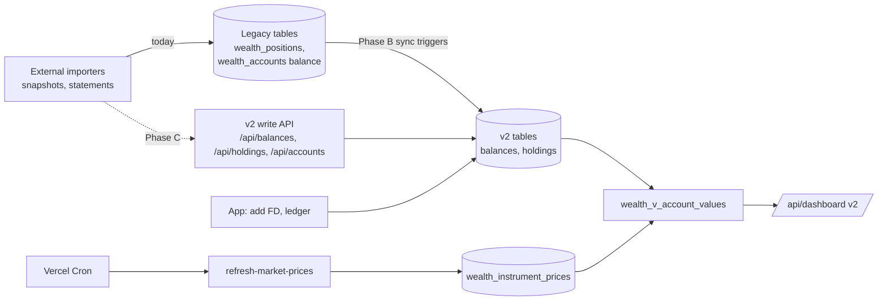
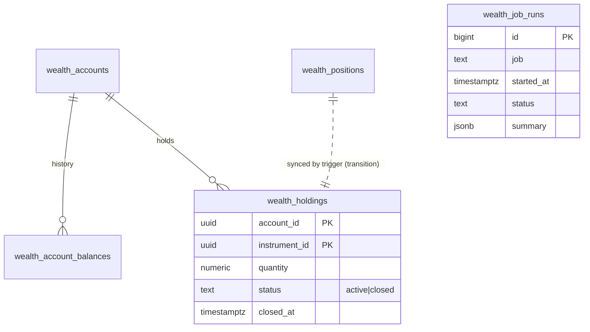

# Technical Specification Document (TSD) — Claude Plan 2

**Wealth Ledger — Account Model Cut-over (v2 becomes the live model)**

## 0. Document control

| Field | Value |
|---|---|
| Document | TSD — Claude Plan 2 |
| Project | Wealth Ledger (`akashkarthi11/wealth`), Vercel project `wealth` |
| Version | 1.1 |
| Date | 2026-11-10 |
| Author | Claude (Claude Code), prepared for the project owner |
| Status | **In progress.** Phases A.3, B, G and D.1 are done and in Production (see §15); C was folded into [Plan 3](claude-plan-3.md) Phase 2; D.2, E and F not started |
| Predecessor | [TSD — Claude Plan 1](claude-plan-1.md) (implemented and deployed to Production 2026-11-10) |
| Companion PSD / FSD | Not created. No new business functionality; this is a technical cut-over |
| Standing rule | **No data is deleted.** Migrations and repairs only add, link or mark rows (Plan 1 v1.2). The runner refuses destructive SQL |

### Revision history

| Version | Date | Change |
|---|---|---|
| 1.0 | 2026-11-10 | First draft, from the state of Production after the Plan 1 deployment |
| 1.1 | 2026-11-11 | Implementation status brought up to date: B and G in Production, C moved to Plan 3, D.1 done, `CRON_SECRET` active |

### Approvals

| Role | Name | Decision | Date |
|---|---|---|---|
| Project owner | _pending_ | | |

Every deployment, database write and environment change needs explicit owner approval for that specific target.

---

## 1. Introduction

### 1.1 Purpose

Plan 1 built the account hierarchy (**user → account (CASA | INVESTMENT | LIABILITY) → subtype → data**) and filled it once from the legacy tables. Production still shows the legacy (v1) model. This plan makes v2 the model people see and the model data is written to, without losing or deleting anything, and with a one-switch rollback at every step.

### 1.2 Scope

| In scope | Out of scope |
|---|---|
| Configuration fixes, keeping v2 in step with legacy writes, write APIs for v2, reconciliation, the switch to v2, UI parity, retiring legacy *reads*, job observability | Deleting legacy tables, columns or rows; new product features; new market-data providers |

### 1.3 References

| Document | Purpose |
|---|---|
| [TSD — Claude Plan 1](claude-plan-1.md) §19 | What was built and deployed |
| [Account hierarchy model](2026-11-10-account-hierarchy-model.md) | v2 data model |
| [Versioned migrations and keys](../modules/database/2026-11-10-versioned-migrations-and-keys.md) | Migrations 0000–0005, applied to Development and Production |
| [Infra README — environments](../modules/infra/README.md) | Vercel teams, databases, `/api/health` |

---

## 2. Current state (verified 2026-11-10, after the Production deployment)

| Area | State | Evidence |
|---|---|---|
| Deployment | Production serves `main` (Plan 1), build `20261110-claude-plan-1` | `vercel inspect`, homepage |
| Data model shown | **v1** for everyone; v2 for the owner with `?model=v2` | `WEALTH_DATA_MODEL` unset |
| Migrations | 0000–0005 applied on Production and Development; build reports `already applied: 6` | build log, `/api/health` |
| v1 ↔ v2 drift | **None yet**: no legacy position, price or transaction writes since the backfill (17:58 UTC) | read-only query |
| v2 totals | CASA ₹1,13,383.53 · Investments ₹3,72,726.35 · Liabilities ₹30,634.21 · Net worth ₹4,55,475.67 | `valuePortfolio` on Production |
| v1 vs v2 difference | ₹5,346.50 US holdings + $10.02 INDmoney cash, excluded in v2 as `missing_fx` | Plan 1 §19 |
| Price refresh | **Never ran**: `CRON_SECRET` missing in Production, so Vercel Cron calls are rejected; all 26 prices are hand-seeded | `/api/health` |
| Development team Preview | Login fails: `WEALTH_SESSION_SECRET` and `WEALTH_ACCESS_KEY` missing | `/api/health` locally with that team's settings |
| Stock Advisor ingest | Last report 17:08 UTC (hourly before that) | read-only query |

### 2.1 Gaps that block the switch

| ID | Gap | Consequence if we switch now |
|---|---|---|
| G1 | v2 has no write path except "add FD"; balances and holdings change only through legacy tables | v2 freezes at the backfill while legacy data moves on |
| G2 | No sync from legacy writes into v2 | Same as G1 for every external import job |
| G3 | A holding cannot be closed: `quantity > 0` and no status column; removal would need a delete | Sold or archived holdings would stay counted, or require deleting rows |
| G4 | No reconciliation report comparing v1 and v2 | The switch cannot be judged objectively |
| G5 | v2 UI lacks invested value / P&L, account detail with balance history, an "add FD" form | Users lose information they have in v1 |
| G6 | Prices never refreshed; USD prices lack FX | US holdings excluded from v2 net worth |
| G7 | Development team Preview misconfigured | No safe place to rehearse the switch |
| G8 | Job results are not recorded; failures are invisible | Stale prices or a stopped importer go unnoticed (e.g. Stock Advisor gap) |
| G9 | Alerts read legacy bills/subscriptions; obligations are not shown per account | Inconsistent with the account view |

---

## 3. Target system flow

### 3.1 Writes during the transition



### 3.2 Cut-over sequence

```mermaid
sequenceDiagram
  participant O as Owner
  participant D as Dev team Preview (Development DB)
  participant P as Production
  O->>D: set env (Phase A), WEALTH_DATA_MODEL=v2
  D->>D: /api/reconcile → only explained differences
  O->>D: use the app for one day
  O->>P: approve; set WEALTH_DATA_MODEL=v2, redeploy
  P->>P: /api/reconcile, /api/health ok
  Note over O,P: Rollback at any time: WEALTH_DATA_MODEL=v1 + redeploy (no data change)
  O->>P: after 14 stable days, approve Phase F (stop legacy reads/writes in code)
```

---

## 4. Impacted components

| Component | Change | Phase |
|---|---|---|
| Vercel env (both teams) | `CRON_SECRET`, `WEALTH_SESSION_SECRET`, `WEALTH_ACCESS_KEY`, `WEALTH_MIGRATIONS`, `WEALTH_DATA_MODEL`, new `WEALTH_INGEST_SECRET` | A, C, D |
| `scripts/migrations/0006_*` | Holding status; legacy → v2 sync triggers | B |
| `scripts/migrations/0007_*` | `wealth_job_runs` | G |
| `scripts/db/resync-v2.sql` (repair) | Idempotent re-sync of v2 from legacy (no deletes) | B |
| `api/balances.js`, `api/holdings.js`, `api/accounts.js` | New v2 write APIs | C |
| `api/reconcile.js` | v1 vs v2 comparison | D |
| `api/health.js` | Price freshness, last job runs, reconciliation summary | A, G |
| `api/refresh-market-prices.js` | Record runs; stop v1 writes after Phase F | G, F |
| `api/dashboard.js`, `app.js` | v2 UI parity; remove v1 paths after Phase F | E, F |
| `api/positions.js` | v1 path removed after Phase F | F |

---

## 5. Technical design by phase

Requirement IDs `TR2-x.y` are referenced by tests (§9) and traceability (§14).

### Phase A — Configuration and fresh prices (owner + 0.5 day)

| ID | Requirement |
|---|---|
| TR2-A.1 | Add `CRON_SECRET` (≥ 16 random characters) to Production; redeploy |
| TR2-A.2 | Development team Preview: `WEALTH_SESSION_SECRET` (≥ 32, different from Production), `WEALTH_ACCESS_KEY`, `WEALTH_MIGRATIONS=on` |
| TR2-A.3 | Trigger `/api/refresh-market-prices` once per environment (owner, with the secret) and confirm `wealth_instrument_prices` rows with `fx_to_inr` for every USD instrument |
| TR2-A.4 | `/api/health` adds `prices: { newest, oldest, staleCount, missingFx }` and the last run of each job (after Phase G) |
| TR2-A.5 | Mark hand-seeded prices `manual` (existing repair `2026-11-10-mark-seeded-prices-manual.sql`, owner approval) |

**Exit:** `/api/health` `ok: true` on Production and the Development team Preview; v2 excludes nothing for missing FX.

### Phase B — Keep v2 in step with legacy writes (1 day)

| ID | Requirement |
|---|---|
| TR2-B.1 | Migration 0006 adds `wealth_holdings.status` (`active` / `closed`, default `active`) and `closed_at`; relaxes `quantity > 0` to `quantity >= 0` when `status = 'closed'`. A holding is closed by marking, never deleted |
| TR2-B.2 | Trigger on `wealth_positions` (insert / update): map the row exactly as the 0004 backfill does; upsert the v2 holding (quantity, invested value, as-of) or, for balance-valued subtypes, insert a `wealth_account_balances` row; when a position becomes `*_ARCHIVED` or its quantity becomes null/0, mark the holding `closed` |
| TR2-B.3 | Trigger on `wealth_accounts` when `current_balance` or `balance_as_of` changes: insert a balance-history row (skip if the same `(account_id, as_of)` exists) |
| TR2-B.4 | Trigger on `wealth_market_prices` (insert/update with status `fresh`): mirror into `wealth_instrument_prices` until Phase F (covers writers other than the refresh job) |
| TR2-B.5 | Views and valuation ignore `closed` holdings; `wealth_v_account_values` filters `status = 'active'` |
| TR2-B.6 | `scripts/db/repairs/resync-v2.sql`: idempotent catch-up of anything written to legacy tables between 0004 and 0006 (inserts and marks only) |

**Exit:** a legacy write of every kind appears in v2 within the same transaction (tested on PGlite and on the Development database).

### Phase C — v2 write API for importers (1 day)

| ID | Requirement |
|---|---|
| TR2-C.1 | `POST /api/accounts` — create an account with a subtype (owner session or ingest bearer); idempotent on `(user_id, account_key)` |
| TR2-C.2 | `POST /api/balances` — append a balance for an account; idempotent on `(account_id, as_of)`; 409 if a different value already exists at that instant |
| TR2-C.3 | `PUT /api/holdings` — set the quantity / invested value of `(account, instrument)`; instrument identified by `assetClass + symbol`, created if missing with its price source; `quantity: 0` closes the holding |
| TR2-C.4 | Ingest authentication: `Authorization: Bearer $WEALTH_INGEST_SECRET` (≥ 32, constant-time) **or** an owner session; the user is resolved server-side as in Stock Advisor ingest |
| TR2-C.5 | Every write is validated against the subtype: `holdings` only for holdings-valued subtypes; currency must match the account |
| TR2-C.6 | Importer contract documented in `docs/modules/integrations/README.md`; external jobs move to these endpoints (owner action: list of jobs, decision DV3) |

### Phase D — Reconcile and switch (0.5 day + 1 day observation per environment)

| ID | Requirement |
|---|---|
| TR2-D.1 | `GET /api/reconcile` (owner): v1 totals (legacy `wealthPosition` rules, ported server-side) vs v2 totals per category and per account, each difference labelled with a reason (`missing_fx`, `missing_price`, `pending_reconciliation`, `only_in_v1`, `only_in_v2`, `value_differs`) |
| TR2-D.2 | Acceptance: every difference has a reason other than `value_differs`/`only_in_*`, or is accepted by the owner in writing (DV1) |
| TR2-D.3 | Development team Preview first: `WEALTH_DATA_MODEL=v2`, owner uses it for a day |
| TR2-D.4 | Production: `WEALTH_DATA_MODEL=v2`, redeploy, `/api/reconcile` and `/api/health` checked within 10 minutes |
| TR2-D.5 | Rollback: `WEALTH_DATA_MODEL=v1` and redeploy; no data change needed in either direction |

### Phase E — v2 UI parity (1.5 days)

| ID | Requirement |
|---|---|
| TR2-E.1 | Invested value and unrealised P&L per holding, account, subtype and category (from `invested_value`; shown only when all parts are known) |
| TR2-E.2 | Account detail view from v2: balance history chart from `wealth_account_balances`, holdings table, linked transactions (`account_id`) and obligations (`account_id`) |
| TR2-E.3 | "Banks" view lists v2 CASA accounts first; imported snapshot sections remain as "source records" below |
| TR2-E.4 | "Add fixed deposit" form using `POST /api/positions` (v2 path) |
| TR2-E.5 | Stale / manual / missing-price badges consistent across hero, cards and rows |
| TR2-E.6 | Alerts and mandates grouped under their account (`account_id` on obligations) |

### Phase F — Retire legacy reads and writes in code (0.5 day, after 14 stable days)

| ID | Requirement |
|---|---|
| TR2-F.1 | Remove the v1 dashboard path (`readPositions`, `wealthPosition`, US INR fallbacks) and the v1 branch of `api/positions.js` |
| TR2-F.2 | Refresh job stops writing `wealth_market_prices` / `wealth_price_history`; drop the Phase B mirror trigger for prices |
| TR2-F.3 | Legacy tables remain, read-only by convention; optional guard trigger that rejects new writes with a clear message (decision DV2). **No table, column or row is dropped** |
| TR2-F.4 | `WEALTH_DATA_MODEL` switch removed after F ships (v2 only) |

### Phase G — Job observability (0.5 day)

| ID | Requirement |
|---|---|
| TR2-G.1 | Migration 0007: `wealth_job_runs (id, job, started_at, finished_at, status, summary jsonb)`; never deleted (bounded size: one row per run) |
| TR2-G.2 | Price refresh, Stock Advisor ingest and any v2 ingest write a run row |
| TR2-G.3 | `/api/health` reports the last run per job and flags: refresh older than 36 h, any job failing twice in a row, Stock Advisor silent for more than 3 h |
| TR2-G.4 | Dashboard banner for the owner when prices are older than 36 h or a job is failing |

---

## 6. Data design

### 6.1 New and changed objects

| Object | Migration | Change |
|---|---|---|
| `wealth_holdings.status`, `closed_at` | 0006 | `status text NOT NULL DEFAULT 'active' CHECK (status IN ('active','closed'))`; `CHECK (quantity > 0 OR status = 'closed')` |
| `wealth_sync_positions_to_v2()` + trigger on `wealth_positions` | 0006 | AFTER INSERT OR UPDATE; same mapping as 0004 |
| `wealth_sync_account_balance()` + trigger on `wealth_accounts` | 0006 | AFTER UPDATE OF `current_balance`, `balance_as_of` |
| `wealth_sync_market_price()` + trigger on `wealth_market_prices` | 0006 | until Phase F |
| `wealth_v_account_values` | 0006 | ignores closed holdings (`CREATE OR REPLACE VIEW`) |
| `wealth_job_runs` | 0007 | new table, PK `id`, index `(job, started_at DESC)` |

All changes are additive and pass the runner's no-data-deletion guard.

### 6.2 Entity relationship (additions)



### 6.3 Sync mapping (Phase B)

| Legacy change | v2 effect |
|---|---|
| New/updated position, holdings subtype, quantity > 0 | Upsert `wealth_holdings` (quantity, invested value, as_of), `status = 'active'` |
| Position quantity null/0, or `record_type` becomes `*_ARCHIVED` | Holding `status = 'closed'`, `closed_at = now()` (row kept) |
| New/updated position, balance subtype (FD, EPF, credit card) | Insert `wealth_account_balances (account, as_of, balance)` if not present |
| `wealth_accounts.current_balance` / `balance_as_of` changes | Insert balance-history row |
| New position whose account or instrument does not exist | Create the account / instrument exactly as 0004 does |

---

## 7. API specification (OpenAPI 3.x, new and changed endpoints)

```yaml
openapi: 3.0.3
info:
  title: Wealth Ledger API — Claude Plan 2 additions
  version: 2.1.0-draft
components:
  securitySchemes:
    session: { type: apiKey, in: cookie, name: wealth_session }
    ingest: { type: http, scheme: bearer, description: WEALTH_INGEST_SECRET }
  schemas:
    Error:
      type: object
      required: [error]
      properties: { error: { type: string } }
    AccountCreate:
      type: object
      required: [subtype, institution, name, currency]
      properties:
        subtype: { type: string, example: savings }
        institution: { type: string, maxLength: 120 }
        name: { type: string, maxLength: 120 }
        maskedIdentifier: { type: string, maxLength: 12, nullable: true }
        currency: { type: string, enum: [INR, USD] }
        accountKey: { type: string, maxLength: 120, description: "Stable key; generated from institution, subtype and name when absent" }
    BalanceCreate:
      type: object
      required: [accountId, asOf, balance]
      properties:
        accountId: { type: string, format: uuid }
        asOf: { type: string, format: date-time }
        balance: { type: number, description: "In the account currency; amount owed for liabilities" }
        status: { type: string, enum: [verified, reported, pending_reconciliation], default: reported }
        note: { type: string, maxLength: 300 }
    HoldingSet:
      type: object
      required: [accountId, assetClass, symbol, quantity, asOf]
      properties:
        accountId: { type: string, format: uuid }
        assetClass: { type: string, enum: [indian_equity, indian_mutual_fund, us_equity, us_etf, precious_metal] }
        symbol: { type: string, maxLength: 120 }
        name: { type: string, maxLength: 160 }
        priceSourceSymbol: { type: string, maxLength: 120, description: "e.g. LT.NS, GC=F, AMFI scheme code" }
        quantity: { type: number, minimum: 0, description: "0 closes the holding (row kept)" }
        investedValue: { type: number, minimum: 0, nullable: true }
        asOf: { type: string, format: date-time }
    Difference:
      type: object
      properties:
        scope: { type: string, example: "INVESTMENT/us_brokerage" }
        v1: { type: number, nullable: true }
        v2: { type: number, nullable: true }
        reason: { type: string, enum: [missing_fx, missing_price, pending_reconciliation, only_in_v1, only_in_v2, value_differs] }
paths:
  /api/accounts:
    post:
      summary: Create an account in the hierarchy (idempotent on account key)
      security: [{ session: [] }, { ingest: [] }]
      requestBody: { content: { application/json: { schema: { $ref: '#/components/schemas/AccountCreate' } } } }
      responses:
        '200': { description: Already existed (same key) }
        '201': { description: Created }
        '400': { description: Invalid subtype, currency or name }
        '401': { description: Not signed in / bad ingest token }
  /api/balances:
    post:
      summary: Append a balance to an account's history
      security: [{ session: [] }, { ingest: [] }]
      requestBody: { content: { application/json: { schema: { $ref: '#/components/schemas/BalanceCreate' } } } }
      responses:
        '200': { description: Same balance already recorded at that time (no change) }
        '201': { description: Recorded }
        '400': { description: Invalid amount, date or status }
        '404': { description: Account not found for this user }
        '409': { description: A different balance is already recorded at that instant }
  /api/holdings:
    put:
      summary: Set the quantity of an instrument in an account (0 closes it; nothing is deleted)
      security: [{ session: [] }, { ingest: [] }]
      requestBody: { content: { application/json: { schema: { $ref: '#/components/schemas/HoldingSet' } } } }
      responses:
        '200': { description: Updated or closed }
        '201': { description: New holding (and instrument if needed) }
        '400': { description: Subtype is balance-valued, or currency mismatch }
        '404': { description: Account not found for this user }
  /api/reconcile:
    get:
      summary: Compare v1 and v2 totals (owner only)
      security: [{ session: [] }]
      responses:
        '200':
          description: Comparison
          content:
            application/json:
              schema:
                type: object
                properties:
                  v1: { type: object, properties: { casa: { type: number }, investments: { type: number }, liabilities: { type: number }, netWorth: { type: number } } }
                  v2: { type: object, properties: { casa: { type: number }, investments: { type: number }, liabilities: { type: number }, netWorth: { type: number } } }
                  differences: { type: array, items: { $ref: '#/components/schemas/Difference' } }
                  acceptable: { type: boolean, description: "true when every difference has an explained reason" }
        '403': { description: Owner only }
  /api/health:
    get:
      summary: Deployment health (yes/no settings, database, migrations, prices, jobs)
      responses:
        '200': { description: Healthy or degraded with a list of problems }
        '503': { description: Database or session secret missing — login cannot work }
```

---

## 8. Validation, authentication, errors

| Rule | Detail |
|---|---|
| Ownership | User resolved from the session, or the admin for ingest tokens; every write checks `account.user_id`; composite FKs already prevent cross-user rows |
| Amounts | Finite, `|x| ≤ 1e12`; balances may be negative only for CASA overdraft (subtype `current`) |
| Dates | ISO 8601 with time zone; not more than 1 day in the future |
| Idempotency | Same request twice gives the same result and no duplicate row (`(account_id, as_of)`, `(account_id, instrument_id)`, `account_key`) |
| Ingest token | `WEALTH_INGEST_SECRET` ≥ 32 characters, constant-time compare; missing secret → 503 with the setting name |
| Errors | 400 validation, 401/403 auth, 404 not this user's account, 409 conflicting value, 503 configuration (no secret values in messages) |
| No deletes | No endpoint deletes balances, holdings, accounts or instruments; closing is a status change |

---

## 9. Testing strategy

| Area | Tests |
|---|---|
| 0006 sync | PGlite: every legacy write kind appears in v2; archive → closed; idempotent; guard accepts the migration (no deletes) |
| Write APIs | Validation, idempotency, ownership, 409 on conflicting balance, quantity 0 closes |
| Reconcile | Fixture where v1 and v2 differ only by explained reasons → `acceptable: true`; injected unexplained difference → `false` |
| UI | v2 rendering of P&L, account detail, badges (VM tests as in Plan 1) |
| Jobs | Refresh records a run; health flags stale prices and silent jobs |
| Real data | Each migration applied to an in-memory copy of the Production backup before any real database |
| Environments | `/api/health` checked on Production, main-team Preview and Development-team Preview after each phase |

---

## 10. Configuration changes

| Setting | Where | Phase |
|---|---|---|
| `CRON_SECRET` | Production (main team) | A |
| `WEALTH_SESSION_SECRET`, `WEALTH_ACCESS_KEY`, `WEALTH_MIGRATIONS=on` | Development team Preview | A |
| `WEALTH_INGEST_SECRET` | Both teams, every environment that receives imports | C |
| `WEALTH_DATA_MODEL=v2` | Development team Preview, then Production | D |
| Point main-team Preview at the Development database (recommended) | Main team Preview | A |

---

## 11. Rollout and rollback

| Step | Target | Rollback |
|---|---|---|
| Phase A settings | Both teams | Remove/restore the setting |
| 0006, 0007 | Development DB → Production DB (backup first, dry run, apply, verify — the Plan 1 procedure) | Code: redeploy previous build; data: triggers can be disabled by a new migration; nothing is deleted |
| Write APIs | Development team Preview → Production | Redeploy previous build |
| Switch to v2 | Development team Preview → Production | `WEALTH_DATA_MODEL=v1` + redeploy |
| Phase F | Production, after 14 days stable on v2 | Redeploy the last build with v1 code |

---

## 12. Risks and limitations

| Risk | Mitigation |
|---|---|
| Sync triggers slow or block an external import | Triggers are row-level and small; any error inside the sync is caught and logged to `wealth_job_runs` instead of failing the legacy write (decided per trigger in review) |
| Unknown external writers keep writing legacy tables after Phase F | Phase B sync stays until DV3 lists every writer; optional guard (DV2) |
| v2 differs from v1 in ways users notice | `/api/reconcile` acceptance gate; rollback switch |
| Preview of the main team uses live data | Recommended: point it at the Development database (§10) |
| Yahoo Finance is unofficial | Unchanged from Plan 1; staleness now visible (Phase G) |

---

## 13. Decisions needed

| # | Decision | Default if unanswered |
|---|---|---|
| DV1 | Accept switching while some items are excluded (e.g. missing FX), as long as each is listed? | No — finish Phase A first so nothing is excluded for FX |
| DV2 | After Phase F, block new writes to legacy tables with a guard trigger? | No guard; documentation only |
| DV3 | Which external jobs write data today (snapshots, statements, email imports, advisor)? | Keep Phase B sync until every job is moved to the v2 API |
| DV4 | EPF / EPS balance (future-dated passbook): count in net worth or list as excluded? | Count, labelled "reported" (current v2 behaviour) |
| DV5 | Ingest authentication: bearer token, owner session, or both? | Both |
| DV6 | How long to keep the v1 code path after switching? | 14 days |

---

## 14. Delivery plan and traceability

| Order | Phase | Effort | Gaps closed |
|---|---|---|---|
| 1 | A Configuration and fresh prices | owner + 0.5 d | G6, G7 |
| 2 | B Sync legacy → v2 | 1 d | G1, G2, G3 |
| 3 | G Job observability | 0.5 d | G8 |
| 4 | D Reconcile and switch | 0.5 d + observation | G4 |
| 5 | C v2 write API | 1 d | G1 (permanent fix) |
| 6 | E UI parity | 1.5 d | G5, G9 |
| 7 | F Retire legacy reads/writes in code | 0.5 d after 14 days | — |

About 5.5 working days plus observation time. Phases A, B and G are the minimum before switching (D); C and E can follow the switch.

## 15. Implementation status

| Phase | Status | Commit | Evidence |
|---|---|---|---|
| A — configuration | **Partly done**: `CRON_SECRET` active in Production (cron runs succeed, 2026-11-11). Open (owner): dev-team settings (Preview → Development database) | — | `/api/health` |
| A.3 — fresh US prices with FX | Done once on Production (5 USD prices, v2 table only); Development fully refreshed | — | v2 INDmoney ₹5,311.06, nothing excluded |
| B — sync legacy → v2 (0006) | **Done and in Production**: applied to Development, then to Production by the `main` build `45e4b96` (2026-11-11) | `68cfe07` | 8 sync tests; on Development 0 issues, 26/26 holdings linked, no rows lost |
| C — v2 write API | **Superseded**: delivered as [Claude Plan 3](claude-plan-3.md) Phase 2 (ingest APIs), in Production | `696a71d` | `plan3.test.mjs` |
| D.2 switch, E, F | Not started. Production still reads v1 (`WEALTH_DATA_MODEL` default); v2 is kept in step by the 0006 triggers | — | `/api/reconcile` |
| G — job observability (0007) | **Done**: `wealth_job_runs`; price refresh and advisor ingest record runs; `/api/health` shows last runs, agent activity, stale/failing jobs. Applied to Development and Production (build `45e4b96`) | — | `reconcile-dq.test.mjs` |
| D.1 — `/api/reconcile` | **Done**: v1 (server port of the live dashboard, parity-tested) vs v2 per category with reasons; on Production all differences are `price_basis`, `acceptable: true` | — | read-only run on Production |
