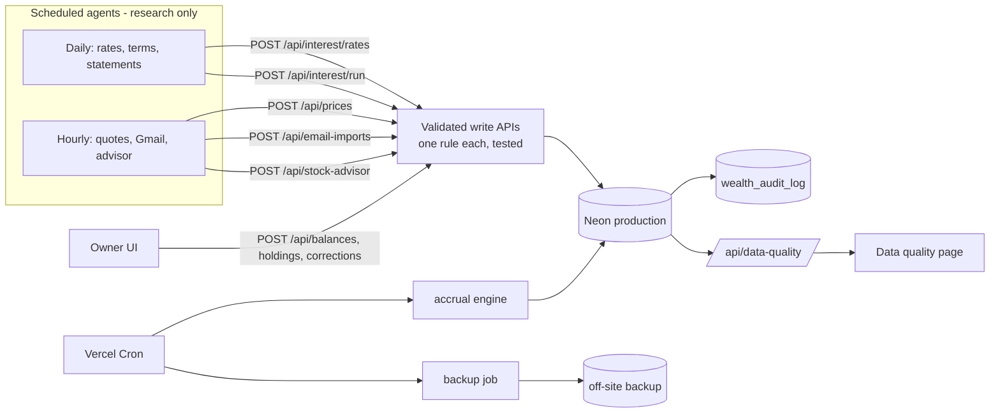

# Technical Specification Document (TSD) — Claude Plan 3

**Wealth Ledger — Data Quality, In-App Automation and Operations**

## 0. Document control

| Field | Value |
|---|---|
| Document | TSD — Claude Plan 3 |
| Project | Wealth Ledger (`akashkarthi11/wealth`), Vercel project `wealth` |
| Version | 1.3 |
| Date | 2026-11-11 |
| Author | Claude (Claude Code), prepared for the project owner |
| Status | **Implemented and deployed to Production** (`main` `b8d040a`, build `20261111-claude-plan-3p`, 2026-11-11; migrations 0008–0011). Owner settings still open — see §14.6 |
| Predecessors | [Claude Plan 1](claude-plan-1.md) (deployed) · [Claude Plan 2](claude-plan-2.md) (Phase B done; cut-over in progress) |
| Companion PSD / FSD | Not created. Technical change only |
| Standing rules | **No data is deleted** (runner guard + test). **Production only** for routine operations; Development is for rehearsal. Every deployment and production write needs explicit owner approval |

### Revision history

| Version | Date | Change |
|---|---|---|
| 1.0 | 2026-11-11 | First draft |
| 1.1 | 2026-11-11 | Phases 1–6 implemented (§14); single-function router; daily-credited interest raises the balance (§14.1, 0009) |
| 1.2 | 2026-11-11 | Deployed to Production; interest view fixes (§14.2); bank balances from the database (§14.3); audit stores changed fields only (§14.4, 0010); only `main` builds on Vercel (§14.5); open owner actions (§14.6) |
| 1.3 | 2026-11-11 | Menu, Investments, Activity and Records pages (§14.7, §14.15); Angel One today's gain (§14.8); broker ledger and P&L (§14.9, 0011); statement imports (§14.10); duplicates and self transfers (§14.11–14.12); FD interest (§14.13); external-writer rules (§14.14); `v2` frozen; §14.6 refreshed |

### Approvals

| Role | Name | Decision | Date |
|---|---|---|---|
| Project owner | _pending_ | | |

---

## 1. Introduction

### 1.1 Purpose

After Plans 1 and 2 the data model is sound and v2 is kept in step with legacy writes. What remains is (a) a handful of known **wrong or unverified values**, and (b) business rules that live only in **scheduled agent prompts** (interest accrual, price ingest, Gmail import) instead of tested code. This plan fixes the data, moves the rules into the app with APIs the agents call, and adds the operational safety nets (backups, audit, data-quality report).

### 1.2 Scope

| In scope | Out of scope |
|---|---|
| Data-quality corrections (by marking/appending, never deleting); interest accrual engine; price, balance and email ingest APIs; data-quality report; obligations read model; automated backups; write audit; environment separation | New product features beyond what exists; trading/order placement; new external data providers; deleting any data |

### 1.3 Relationship to Plan 2

Plan 3 assumes Plan 2 Phases A (configuration), B (sync) and D (switch) are done or in progress. Plan 2 Phase C (v2 write APIs) is **extended here** into the ingest APIs of Phase 2 below; implement them once, here.

---

## 2. Current state and gaps (2026-11-11)

### 2.1 Known data issues

| ID | Issue | Evidence | Effect today |
|---|---|---|---|
| DQ-1 | **Nippon India Large Cap Fund units = 29.02** on file; saved value ₹7,202 at real NAV ₹103.37 implies ≈ 69.7 units | MFAPI scheme 118632; Angel One DP statement 31 Oct vs MF snapshot 10 Nov | A fresh NAV would show ₹3,000; NAV writes are on hold in the hourly prompt |
| DQ-2 | **Metal price source undecided**: Paytm-derived (₹14,708/g gold, ₹197.27/g silver), IBJA benchmark (₹14,242 / ₹186), futures parity (≈ ₹12,160 gold) | v1 vs v2 comparison | v1 and v2 differ by ₹1,600; the daily refresh would switch to futures parity |
| DQ-3 | **5 identical transaction pairs** (Zarivault ₹950 ×2 dates, Awfis ₹100 ×2 dates, transfer ₹1,202) | audit query 1 | Possibly double-counted spending (≈ ₹4,302) |
| DQ-4 | **FD terms unknown**: Slice FD (₹3,004.41, 7.75%) and Angel One FD (₹1,001.09, 8.00%) lack principal, booking date, maturity, payout | daily prompt | No FD accrual; maturity alerts impossible |
| DQ-5 | **EPF ₹93,726** carries a future passbook date (31 Mar 2027) and a "not verified" warning | position metadata | Counted in net worth as "reported" |
| DQ-6 | **Two open Slice Savings rate periods** (both 5.5%, from 7 Oct and 9 Nov) | rates table | Ambiguous "current rate"; repair script ready, not applied |
| DQ-7 | **Hand-seeded prices still marked fresh** in v1 | price audit | v1 presents them as live |
| DQ-8 | **45 transactions without an account** | account audit | Excluded from per-account views |
| DQ-9 | **Credit card ₹30,634.21 vs ₹30,536.95** (statement outstanding vs cycle liability) | position metadata | Which figure is "owed" is unclear |

### 2.2 Logic that lives only in prompts

| Rule | Where today | Risk |
|---|---|---|
| Daily interest accrual (balance × rate ÷ 365/366, revisions, catch-up) | Daily agent prompt | Arithmetic and idempotency depend on an LLM run; not unit-tested |
| Price ingest (both tables, newest-only, USD needs FX, source names) | Hourly agent prompt | SQL pasted into a prompt; schema changes silently break it |
| Gmail import (dedupe, `external_ref`, account choice) | Hourly agent prompt | Same |
| Balance updates from screenshots | Ad hoc | No validation, no audit |

### 2.3 Operational gaps

| ID | Gap |
|---|---|
| OP-1 | Backups are manual JSON dumps on one laptop (`.db-backups/`) |
| OP-2 | No audit trail of who/what changed a financial row (agents, owner, migrations) |
| OP-3 | Main-team Preview deployments use the Production database |
| OP-4 | No single "is my data trustworthy?" view: issues are spread across audits, health and prompts |
| OP-5 | Obligations are still three tables (bills, mandates, obligations); alerts read the legacy ones |

---

## 3. Target design



Agents keep the judgment work (finding official rates, reading emails, writing advice). The app owns the arithmetic, validation, deduplication and storage.

---

## 4. Phases and requirements

### Phase 1 — Data-quality corrections (owner decisions + 0.5 day)

Every correction appends or marks; the previous value is kept in history or notes.

| ID | Requirement | Owner input |
|---|---|---|
| TR3-1.1 | Correct Nippon units: new holding quantity via `PUT /api/holdings` (or a repair) with evidence note; legacy position updated so Phase B keeps v2 in step; release the NAV hold in the hourly prompt | Confirmed unit count from Angel One |
| TR3-1.2 | Metal price policy recorded in `wealth_instruments.price_source` / `price_source_symbol`; refresh job honours it (no futures parity unless chosen) | Choice: IBJA benchmark, provider sell rate, or futures |
| TR3-1.3 | Identical transaction pairs: owner marks each as duplicate or genuine. Duplicates are **marked** (`wealth_transactions.duplicate_of` → the kept row) and excluded from totals — not deleted | Decision per pair |
| TR3-1.4 | FD terms captured on the FD account (principal, booked_on, maturity_on, rate, payout, compounding) | Values from Slice / Angel One |
| TR3-1.5 | EPF: status `reported` vs excluded; record passbook date | Decision (Plan 2 DV4) |
| TR3-1.6 | Apply the prepared repairs: close the duplicate Slice rate period; mark seeded prices `manual` | Approval |
| TR3-1.7 | Credit card: store statement outstanding and current cycle separately (balance note / two balance rows with labels) | Which figure counts as owed |
| TR3-1.8 | Unassigned transactions: suggest an account from description/history; owner confirms per batch | Confirmation |

### Phase 2 — Ingest APIs (agents call these instead of writing SQL) (1.5 days)

| ID | Requirement |
|---|---|
| TR3-2.1 | `POST /api/prices` — batch of `{assetClass, symbol, price, currency, asOf, source, fxToInr}`; validates source list, newest-only, USD needs FX; writes v2 and (until Plan 2 Phase F) legacy; returns per-item status |
| TR3-2.2 | `POST /api/email-imports` — `{messageId, outcome, transaction?}`; idempotent on message id; creates the transaction with `external_ref = gmail:<id>[:n]`; rejects non bank/card accounts; returns `imported / matched_existing / needs_review / ignored` |
| TR3-2.3 | `GET /api/email-imports/seen?ids=…` — which message ids are already processed (so agents never fetch a seen body) |
| TR3-2.4 | `POST /api/balances`, `PUT /api/holdings`, `POST /api/accounts` — as specified in Plan 2 Phase C |
| TR3-2.5 | Authentication: `Authorization: Bearer $WEALTH_INGEST_SECRET` (≥ 32, constant-time) or owner session; user resolved server-side |
| TR3-2.6 | Agent prompts (`docs/ops/*.md`) rewritten to call these endpoints; no SQL left in prompts |

### Phase 3 — Interest accrual engine (1.5 days)

| ID | Requirement |
|---|---|
| TR3-3.1 | Interest source registry in code: interest-bearing v2 accounts × `wealth_interest_products`, with an explicit link table `wealth_interest_links (account_id, product_id, partition_key)` (FKs, unique) replacing the prompt's hard-coded mapping |
| TR3-3.2 | `POST /api/interest/rates` — agent submits verified rate periods (product, rate, effective_from, source_url, evidence); the app closes the previous open period and never duplicates |
| TR3-3.3 | Accrual engine (pure function + SQL writer): principal = latest verified balance ≤ end of day (IST), rate = period covering the day, `interest = principal × rate ÷ 365/366`, 8-decimal rounding; catches up missed days; writes `revision = 1` rows; on changed inputs appends a correction revision with `supersedes_id` |
| TR3-3.4 | FD accrual once TR3-1.4 terms exist: simple/compound per payout, stops at maturity |
| TR3-3.5 | Runs daily via Vercel Cron (`/api/interest/run`, `CRON_SECRET`); also callable by the owner/agent; idempotent |
| TR3-3.6 | Actual credit recording (`POST /api/interest/credits`): transaction with `external_ref` + verified balance row; never inferred from accruals |
| TR3-3.7 | Interest view in the UI reads products, rates, accruals and credits from v2 (per account, per product) |

### Phase 4 — Data-quality report (0.5 day)

| ID | Requirement |
|---|---|
| TR3-4.1 | `GET /api/data-quality` (owner): one list of open issues with severity, evidence and the action that resolves it — stale balances (> 48 h), stale prices (> 36 h), missing FX, unlinked interest accounts, sync issues, duplicate candidates, unassigned transactions, unverified balances (EPF), FD terms missing, last run of each job |
| TR3-4.2 | "Data quality" page in More; badge count on the hero when there are high-severity issues |
| TR3-4.3 | Each issue has a stable id so the owner can mark it "accepted" (stored, with reason) instead of seeing it every day |

### Phase 5 — Obligations read model (1 day)

| ID | Requirement |
|---|---|
| TR3-5.1 | Alerts and "Subscriptions & mandates" read from `wealth_recurring_obligations` + `wealth_payment_occurrences` (with the 0005 FKs), grouped by account |
| TR3-5.2 | Legacy `wealth_planned_bills` / `wealth_subscriptions` stay writable for external jobs; triggers (as in Phase B) keep obligations in step |
| TR3-5.3 | De-duplication of alerts by obligation id (replacing the name-normalising heuristic in `app.js`) |

### Phase 6 — Operations: backups, audit, environments (1 day)

| ID | Requirement |
|---|---|
| TR3-6.1 | Daily automated backup: JSON (or `pg_dump` via Neon branch snapshot) to private off-site storage, retained ≥ 30 days; restore drill documented and tested on the Development database |
| TR3-6.2 | `wealth_audit_log (id, at, actor, action, table_name, row_id, before jsonb, after jsonb)` written by triggers on financial tables (accounts, balances, holdings, transactions, rates, ledger); actor from `SET LOCAL wealth.actor` (API) or 'external' |
| TR3-6.3 | Main-team Preview pointed at the Development database; Production-only secrets scoped to Production |
| TR3-6.4 | Key rotation procedure for `WEALTH_SESSION_SECRET`, `WEALTH_INGEST_SECRET`, `CRON_SECRET` (session secret rotation signs everyone out — documented) |

---

## 5. Data design

| Object | Phase | Change |
|---|---|---|
| `wealth_transactions.duplicate_of` | 1 | `uuid NULL`, composite FK `(user_id, duplicate_of)` → transactions; totals exclude marked duplicates |
| FD terms on `wealth_accounts` | 1 | `principal numeric`, `booked_on date`, `maturity_on date`, `payout text CHECK`, `compounding text CHECK` (nullable; only for `fixed_deposit`) |
| `wealth_interest_links` | 3 | PK `(account_id, product_id, partition_key)`; FKs to accounts and products |
| `wealth_data_quality_acceptances` | 4 | PK `(user_id, issue_id)`, reason, accepted_at |
| obligation sync triggers | 5 | legacy bills/subscriptions → obligations/occurrences |
| `wealth_audit_log` | 6 | append-only; never deleted (bounded by retention decision DV3-4) |

All migrations pass the no-deletion guard; columns are added nullable; nothing is dropped.

---

## 6. API specification (OpenAPI 3.x)

```yaml
openapi: 3.0.3
info:
  title: Wealth Ledger API — Claude Plan 3 additions
  version: 3.0.0-draft
components:
  securitySchemes:
    session: { type: apiKey, in: cookie, name: wealth_session }
    ingest: { type: http, scheme: bearer, description: WEALTH_INGEST_SECRET }
    cron: { type: http, scheme: bearer, description: CRON_SECRET }
  schemas:
    PriceItem:
      type: object
      required: [assetClass, symbol, price, currency, asOf, source]
      properties:
        assetClass: { type: string, enum: [indian_equity, indian_mutual_fund, us_equity, us_etf, precious_metal] }
        symbol: { type: string, maxLength: 120 }
        price: { type: number, exclusiveMinimum: true, minimum: 0 }
        currency: { type: string, enum: [INR, USD] }
        asOf: { type: string, format: date-time }
        source: { type: string, enum: [NSE, BSE, StockAnalysis.com real-time quote, ChartExchange real-time quote, Yahoo Finance, MFAPI.in, AMFI NAV, IBJA AM benchmark 999, IBJA PM benchmark 999] }
        fxToInr: { type: number, nullable: true, description: "Required when currency is USD" }
    ItemResult:
      type: object
      properties:
        key: { type: string }
        status: { type: string, enum: [stored, already_stored, older_than_latest, on_hold, rejected] }
        reason: { type: string, nullable: true }
    EmailImport:
      type: object
      required: [messageId, outcome]
      properties:
        messageId: { type: string, maxLength: 200 }
        outcome: { type: string, enum: [import, ignored, needs_review] }
        transactions:
          type: array
          items:
            type: object
            required: [kind, category, amount, accountId, occurredOn]
            properties:
              kind: { type: string, enum: [income, expense, transfer, investment, liability] }
              category: { type: string, maxLength: 60 }
              description: { type: string, maxLength: 180 }
              amount: { type: number, exclusiveMinimum: true, minimum: 0 }
              accountId: { type: string, format: uuid }
              occurredOn: { type: string, format: date }
    RatePeriod:
      type: object
      required: [productKey, annualRate, effectiveFrom, sourceUrl]
      properties:
        productKey: { type: string }
        annualRate: { type: number, minimum: 0, maximum: 1, description: "Decimal fraction, 0.055 = 5.5%" }
        effectiveFrom: { type: string, format: date }
        sourceUrl: { type: string }
        evidence: { type: string, maxLength: 500 }
    Issue:
      type: object
      properties:
        id: { type: string }
        severity: { type: string, enum: [high, medium, low] }
        category: { type: string, example: stale_price }
        message: { type: string }
        evidence: { type: object }
        action: { type: string }
        accepted: { type: boolean }
paths:
  /api/prices:
    post:
      summary: Store a batch of verified prices (v2, and legacy until Plan 2 Phase F)
      security: [{ ingest: [] }, { session: [] }]
      requestBody: { content: { application/json: { schema: { type: object, properties: { items: { type: array, maxItems: 200, items: { $ref: '#/components/schemas/PriceItem' } } } } } } }
      responses:
        '200': { description: Per-item results, content: { application/json: { schema: { type: object, properties: { results: { type: array, items: { $ref: '#/components/schemas/ItemResult' } } } } } } }
        '400': { description: Invalid batch }
        '401': { description: Bad or missing token }
  /api/email-imports:
    post:
      summary: Record the outcome of one reviewed email (idempotent on messageId)
      security: [{ ingest: [] }]
      requestBody: { content: { application/json: { schema: { $ref: '#/components/schemas/EmailImport' } } } }
      responses:
        '200': { description: "Already recorded, or matched an existing transaction" }
        '201': { description: Recorded (and transactions imported) }
        '400': { description: Invalid transaction or account is not a bank/card account }
  /api/email-imports/seen:
    get:
      summary: Which message ids are already processed
      security: [{ ingest: [] }]
      parameters:
        - { in: query, name: ids, required: true, schema: { type: string, description: "Comma-separated, max 500" } }
      responses:
        '200': { description: List of seen ids, content: { application/json: { schema: { type: object, properties: { seen: { type: array, items: { type: string } } } } } } }
  /api/interest/rates:
    post:
      summary: Submit a verified rate period; previous open period is closed, never duplicated
      security: [{ ingest: [] }, { session: [] }]
      requestBody: { content: { application/json: { schema: { $ref: '#/components/schemas/RatePeriod' } } } }
      responses:
        '200': { description: Same rate already current (no change) }
        '201': { description: New period recorded }
        '400': { description: Unknown product or invalid rate }
  /api/interest/run:
    post:
      summary: Run the accrual engine (catch-up to yesterday IST, idempotent)
      security: [{ cron: [] }, { ingest: [] }, { session: [] }]
      responses:
        '200':
          description: Per-account result
          content:
            application/json:
              schema:
                type: object
                properties:
                  through: { type: string, format: date }
                  accounts:
                    type: array
                    items:
                      type: object
                      properties:
                        accountKey: { type: string }
                        status: { type: string, enum: [calculated, pending_terms, stale_balance, no_rate, needs_link] }
                        rowsWritten: { type: integer }
                        corrections: { type: integer }
                        interestTotal: { type: number }
  /api/data-quality:
    get:
      summary: Open data-quality issues (owner)
      security: [{ session: [] }]
      responses:
        '200': { description: Issues, content: { application/json: { schema: { type: object, properties: { issues: { type: array, items: { $ref: '#/components/schemas/Issue' } } } } } } }
        '403': { description: Owner only }
```

---

## 7. Validation, authentication, errors

Same conventions as Plans 1–2: owner session or ingest bearer; user resolved server-side; composite FKs prevent cross-user rows; 400 validation, 401/403 auth, 404 not this user's record, 409 conflicting value, 503 configuration. All write endpoints are idempotent and never delete.

## 8. Testing strategy

| Area | Tests |
|---|---|
| Accrual engine | Leap years, rate change mid-period, missing/stale balance, catch-up, correction revisions, idempotency; parity with the existing 5 ledger rows |
| Ingest APIs | Validation, newest-only prices, USD without FX rejected, email idempotency, wrong account type rejected |
| Data-quality report | Each issue type from fixtures; acceptance hides it |
| Migrations | PGlite fresh + copy of the production backup; no-deletion guard |
| Agents | Dry-run mode of each endpoint (`?dryRun=1`) so prompts can be tested without writing |

## 9. Configuration

| Setting | Phase |
|---|---|
| `WEALTH_INGEST_SECRET` | 2 |
| Cron entries: `/api/interest/run` (daily 20:00 UTC = 01:30 IST), backup job | 3, 6 |
| Backup storage credentials (Production only) | 6 |
| Preview → Development database | 6 |

## 10. Rollout

Development database first, then Production, each with backup → dry run → apply → verify (the Plan 1/2 procedure). Agents switch to the APIs only after the endpoints are live and verified; until then the current prompts keep working (Phase B sync covers their legacy writes).

## 11. Risks

| Risk | Mitigation |
|---|---|
| Wrong correction values (units, FD terms) | Owner-confirmed only; previous values kept; reversible by a new correction |
| Agents and app both writing during migration to APIs | Idempotent keys (`external_ref`, `(instrument, as_of, source)`, ledger unique key) make double writes harmless |
| Audit log growth | Small row size; retention decision DV3-4; never auto-deleted without approval |
| Accrual engine disagrees with past agent rows | Parity test; differences become correction revisions, not overwrites |

## 12. Decisions needed

| # | Decision | Default |
|---|---|---|
| DV3-1 | Nippon unit count (DQ-1) | NAV hold stays until provided |
| DV3-2 | Metal price source (DQ-2) | IBJA benchmark per gram |
| DV3-3 | Each identical transaction pair: duplicate or genuine (DQ-3) | Genuine (no change) |
| DV3-4 | Audit-log and backup retention | Keep all audit rows; backups 30 days |
| DV3-5 | Where off-site backups go (private storage of your choice) | Private Vercel Blob store |
| DV3-6 | Credit card "owed" figure (DQ-9) | Statement outstanding |

## 13. Delivery plan

| Order | Phase | Effort | Closes |
|---|---|---|---|
| 1 | 1 Data-quality corrections | owner + 0.5 d | DQ-1 … DQ-9 |
| 2 | 4 Data-quality report | 0.5 d | OP-4 |
| 3 | 2 Ingest APIs + prompt rewrite | 1.5 d | §2.2 |
| 4 | 3 Interest accrual engine | 1.5 d | §2.2, DQ-4 |
| 5 | 6 Backups, audit, environments | 1 d | OP-1 … OP-3 |
| 6 | 5 Obligations read model | 1 d | OP-5 |

About 6 working days plus owner input. Phase 1 needs decisions DV3-1 … DV3-3 and DV3-6 before it can run.

## 14. Implementation status (2026-11-11)

**Deployed to Production** (`main` `b8d040a`, app build `20261111-claude-plan-3p`; v1.2 baseline was `2a2afde`, build `3h`). Tests: 147 passing. Migrations 0008, 0009, 0010 and 0011 are applied to Development and Production, each after an encrypted backup and a passing restore drill. `/api/health` reports 12 migrations (latest `0011_broker_ledger`); its `ok` is `false` only because `WEALTH_INGEST_SECRET` and the backup store are not set yet (§14.6).
The earlier failed `main` deploy (Hobby 12-function limit) is fixed by the single-function router (see [fix record](../modules/infra/2026-11-11-hobby-function-limit-single-router.md)).

| Phase | Status | Evidence |
|---|---|---|
| 1 — Data-quality corrections | **Tooling done; owner decisions pending**: duplicate marking (`duplicate_of`, excluded from totals), FD terms columns + `PATCH /api/accounts`, quantity correction with evidence (`PUT /api/holdings`), Nippon price hold (DQ-1), metal policy (India benchmark by default; futures only with `WEALTH_METAL_PRICE_SOURCE=futures`), duplicate Slice rate period closed by 0008, account suggestions for unassigned transactions. Credit card "owed" figure: two labelled balances via `POST /api/balances` | `plan3.test.mjs`; Development: rate period closed, hold set |
| 2 — Ingest APIs | **Done**: `POST /api/prices`, `POST /api/email-imports`, `GET /api/email-imports/seen`, `POST /api/balances`, `PUT /api/holdings`, `POST/PATCH /api/accounts`, `/api/transaction-review`; Bearer `WEALTH_INGEST_SECRET` or owner session; `?dryRun=1`; agent prompts rewritten ([daily](../ops/daily-wealth-operations-prompt.md), [hourly](../ops/hourly-wealth-operations-prompt.md)) — use them only after the Production deploy | `plan3.test.mjs` |
| 3 — Interest engine | **Done**: `wealth_interest_links` (4 links seeded), `POST /api/interest/rates`, `POST /api/interest/run`, `POST /api/interest/credits`, `GET /api/interest` + Interest sources panel; nightly cron `/api/nightly` 01:30 IST. Dry run on Development: Slice Savings ₹7.21509589 and Atom ₹9.55643836 for 10 Nov (same formula as the agent rows); FDs `pending_terms`; BOI/HDFC/Roarbank `needs_link` | `plan3.test.mjs` (leap year, rate change, stale principal, catch-up, corrections, confirmed rows untouched, idempotency) |
| 4 — Data-quality report | **Done** (earlier); now also reports price holds, FD terms, interest links, nightly jobs, backup and ingest configuration | `reconcile-dq.test.mjs` |
| 5 — Obligations read model | **Done**: triggers keep obligations/occurrences in step with legacy bills and mandates; `GET /api/obligations` (grouped by account); alerts de-duplicate by obligation id | `plan3.test.mjs` |
| 6 — Operations | **Done in code; owner settings pending**: encrypted nightly backup to a private Blob store, restore tool + drill (passed on Development data: 29 tables, 1,218 rows), `wealth_audit_log` with actor, [runbook](../ops/operations-runbook.md) for environments and key rotation. Needs `WEALTH_BACKUP_KEY`, a private Blob store, `WEALTH_INGEST_SECRET`, and Preview → Development database | `plan3.test.mjs` (backup round trip, tamper, restore) |

### 14.1 Change 2026-11-11 — daily-credited interest raises the balance (owner decision: "Estimated")

- Products that the bank credits daily (`wealth_interest_products.credit_frequency = 'daily'`: Slice Savings, Slice Atom — migration 0009) now behave like the bank account:
  - each day's principal includes the interest credited since the last verified balance (compounding, rounded to paise per day);
  - after the nightly run, an **estimated** balance is appended: last verified balance + interest credited since.
- Where the estimate is stored:
  - v2: a `wealth_account_balances` row with status `estimated`, counted in net worth;
  - v1: `wealth_accounts.current_balance` with `balance_status = 'stale'`, which v1 now counts in CASA. v1 shows it as "estimated: last verified + interest".
- The next verified balance (screenshot, `POST /api/balances`) replaces it. Estimates stay in the history.
- Accrual still needs a verified balance no older than 2 days, so estimates stop growing when screenshots stop.
- Accruals are never written as income transactions. Actual credits with bank evidence still go through `POST /api/interest/credits`.
- **Old daily prompt:** it requires the newest balance row to be `verified`, so after an estimate it reports the principal as stale and writes nothing. The app's nightly run does the accrual. Switch the task to the new API prompt.
- **Status:** migration 0009 is applied to Development and Production (`main` build `337a88f`). The dry run gives Slice ₹47,889.22 and Atom ₹63,429.56 for 10 Nov. Those two estimated balances were written to Production for 11 Nov at the owner's request ("for today update in db"); the nightly run keeps them current from then on.

### 14.2 Change 2026-11-11 — interest view shows correct day and month totals

- A day's total sums every correction revision, not only the newest row. Before this, 9 Nov showed −₹7.21, which was the correction alone.
- The month total is the statement total plus the accruals after the statement's end date (`interestMonthTotal`). Before this, the chart and the statement total ignored days the statement did not cover.
- Fix record: [interest view totals](../modules/interest/2026-11-11-interest-view-day-and-month-totals.md). Commits `f42727e`, `79ff474`; in Production from `0a91031`.

### 14.3 Change 2026-11-11 — bank balances come from the database

- The Bank balances menu uses the same live account balances as the dashboard. Before this, it showed figures from saved snapshot tables, so the two disagreed.
- The widget was redesigned: a total, a share bar, a legend, and a verified/estimated split, then one row per bank with a status chip.
- The account details page is built from the database through a new `GET /api/account-detail?id=<account uuid>` (owner session only, own accounts only). It shows the account and subtype, 30 balance rows, 6 months of money in/out (transfers kept separate), the 25 latest transactions, interest (month-to-date total and basis), and upcoming obligations. No static snapshot data is used, and each page shows only that bank's records.
- Fix record: [bank balances from the database](../modules/accounts/2026-11-11-bank-balances-live-and-account-details.md). Commits `b84be41`, `dfe0aec`, `68ec9a7`, `25983f2`; in Production from `2a2afde`.

### 14.4 Change 2026-11-11 — store only required data (migration 0010)

- Owner rule: "store only required data, don't save waste data".
- `wealth_trg_audit` now stores only the changed columns on an update. An update that changes nothing except `updated_at` is not recorded. Inserts store the new row; deletes store the old row. Existing audit rows are kept.
- The price refresh and `POST /api/prices` no longer write `wealth_price_history`; `wealth_instrument_prices` is the history.
- Each account has one rolling estimated balance, updated in place until the next verified balance, instead of a new row every night. Verified balances are never touched.
- Fix record: [audit stores changed fields only](../modules/database/2026-11-11-store-only-required-data.md). Commit `501bcab`; in Production from `2a2afde`.

### 14.5 Change 2026-11-11 — only `main` builds on Vercel

- `vercel.json` `git.deploymentEnabled = {"**": false, "main": true}`. Pushes to `claude-dev`, `development` and `v2` no longer create deployments.
- Fix record: [Vercel builds main only](../modules/infra/2026-11-11-vercel-build-main-only.md). Commits `77768a8`, `20a5b21`.
- Branch `v2` was created from `main`. **Owner rule (2026-11-11): never merge into `v2`** — it stays at `06df8a5`. Releases go `claude-dev` → `development` → `main` only.

### 14.6 Open owner actions (refreshed for v1.3)

| Action | Why | State |
|---|---|---|
| Set `WEALTH_INGEST_SECRET` in Production, then move the scheduled agents to the [daily](../ops/daily-wealth-operations-prompt.md) and [hourly](../ops/hourly-wealth-operations-prompt.md) API prompts | The hourly prompt still in use (ChatGPT) writes SQL directly, including `wealth_price_history`, which §14.4 stopped using | Open |
| Hourly cloud routine (Claude) | Prepared (8 AM–10 PM IST, cron `30 2-16 * * *`, Gmail connector, paused) but **not created**: claude.ai has no GitHub access, and `WEALTH_DATABASE_URL` is not in the cloud environment. Owner: "leave this now" | Parked |
| Create a private Vercel Blob store and set `WEALTH_BACKUP_KEY` | Nightly backup is skipped until both are set (`/api/health` `ok:false`) | Open |
| Nippon India Large Cap units (29.02 stored vs ≈ 69.7 implied) | DV3-1; NAV not stored until confirmed | Open |
| FD maturity dates (Slice FD, Angel One FD) | Interest accrues with no end date until given (§14.13) | Open |
| Preview deployments → Development database | Preview uses the Production database | Open |
| Stock Advisor report retention (hourly, on change, or daily) | Decision pending | Open |
| Workbook-only look-alike pairs (Zarivault ₹950 on 25 May, Awfis ₹100 on 1 Jul) | Kept as two payments unless the owner says otherwise (§14.11) | Open |
| Crypto (CoinDCX ₹3,59,251 in 2023-24), NDX P2P ₹15,000, monthly ₹21,600 to HDFC ••7649 | Seen in statements; not modelled (§14.10) | Owner to raise |
| ~~FD terms~~, ~~duplicate pairs~~ | Done in §14.13 and §14.11 | Closed |

### 14.7 Change 2026-11-11 — menu grouping, Investments and Activity pages

- **Menu:** grouped as Money (Overview, Banks, Investments, Interest) · Activity (Transactions, Alerts, Subscriptions) · Tools ▾ (Stock Advisor, Angel One, Records, Data quality — owner only). Mobile bar: Home · Banks · Invest · Activity · More (alert badge). Owner choice "grouping better". Commit in `06df8a5`.
- **Investments page** is built from holdings (`investmentsPageModel`), so its total equals the dashboard's investments figure; groups INR / US / FD / PF with price time and P&L per holding. Fix record: [Investments from holdings](../modules/investments/2026-11-11-investments-page-from-holdings.md).
- **Activity page:** period presets (opens on this month), money in / out / net / transfers summary (out = spending + investments + card payments; transfers apart), day and month groups, search and filters kept across re-render, "Show more" paging. Fix record: [Activity redesign](../modules/accounts/2026-11-11-activity-page-redesign.md).
- **More menu:** the "Financial overview" item (same as Home) is removed; the balance summary stays. Commit `44c3f6f`; in Production from `f27100f` (build `3q`).
- Tests: `menu.test.mjs`, `investments.test.mjs`, `activity.test.mjs`. In Production from `041fc03` (Investments, Activity).

### 14.8 Change 2026-11-11 — Angel One "today's gain"

- `legacyPositionRows` returns `market_price_as_of`, `market_previous_close`, `market_previous_close_at` (LATERAL join on `wealth_instruments` / `wealth_instrument_prices`, with fallbacks).
- Previous close = the last price before the latest price's IST trading day, so holidays (10 Nov 2026, NSE closed) and weekends work. The dashboard card shows "Today's gain" or "Day change · date", and "—" when unknown.
- Fix record: [Angel One today's gain](../modules/investments/2026-11-11-angel-one-today-gain.md). Test: `daychange.test.mjs`. In Production from `041fc03`.

### 14.9 Change 2026-11-11 — Angel One funds ledger and P&L (migration 0011)

- New table `wealth_broker_ledger` (unique on user, broker, ledger, voucher, entry type, date, debit, credit). Kinds: `funds_added`, `funds_withdrawn` (incl. quarterly settlement), `trade`, `charge`, `mtf_transfer`, `credit_other`.
- `api/_broker.js`: `parseLedgerSheet` (checks the sheet's totals and closing balance), `importBrokerLedger` (bulk, idempotent), `matchBrokerFunds` (funds-added rows matched to bank transactions within ±3 days; "pending/verify" categories renamed "Funds added to Angel One"), `brokerSummary`; `parsePnlSheet` / `pnlSourceKey` for the P&L report.
- Scripts: `scripts/db/xlsx-lib.mjs` (no-dependency xlsx reader), `import-broker-ledger.mjs`, `import-broker-pnl.mjs` (check-only by default; `--apply --yes`).
- Production: 952 ledger entries — net put in ₹2,12,232.98, charges ₹4,442.10, MTF closed 5 Dec 2025; 3 transfers matched. P&L snapshot: net ₹24,173. The broker panel sits inside the equity group on Investments.
- Fix record: [Angel One ledger history](../modules/integrations/2026-11-11-angel-one-ledger-history.md). Test: `broker.test.mjs`. In Production from `4d2a262` (0011) and `080521c` (P&L).

### 14.10 Change 2026-11-11 — statement imports (super.money, Paytm, HDFC)

All imports: extracted with a parser and checked against the statement's printed totals; Development rehearsal; encrypted Production backup; idempotent (a re-run adds nothing); audited as owner; no name, PAN, phone or email stored.

| Source | Result in Production |
|---|---|
| super.money UPI history (PDF) | 8 missing Slice Savings payments added; reference record kept |
| Paytm UPI statement, Nov 2023 – Nov 2024 (151-page PDF) | Summary record + **1,014 transactions** (846 paid ₹10,70,611.47, 117 received ₹6,73,561.70, 53 self-transfers; 2 printed twice kept once) |
| HDFC ••9498 statements, Apr 2025 – 10 Nov 2026 (2 password-protected PDFs) | **638 transactions**; every running balance chains and the STATEMENT SUMMARY matches; 3 rows already stored skipped; self transfers (80, ₹14,00,426) labelled as transfers |

- Months before 21 May 2026 hold only these sources, so long-range spending averages read low.
- Fix record: [account history](../modules/accounts/2026-11-11-supermoney-upi-history.md).

### 14.11 Change 2026-11-11 — duplicate spending removed

- Check: rows with the same date, account and amount (99 groups). The Slice credit card had 93 payments stored twice (workbook import + Slice statement import), ₹1,26,297.54.
- Repair [`2026-11-11-mark-slice-card-duplicates.sql`](../../scripts/db/repairs/2026-11-11-mark-slice-card-duplicates.sql) marked each plain row `duplicate_of` its statement twin (one-to-one by `row_number`). On the owner's explicit request ("delete") the 93 marked rows were then **deleted** — a one-off exception to the no-deletion rule, run from outside `scripts/db/repairs` so the guard test stays strict; backup `prod-before-dupe-delete.wlb`; the script refused to run unless exactly 93 unreferenced marked rows matched.
- 12 look-alike groups are kept (different payees, different UPI references, or two entries on the statement itself).

### 14.12 Change 2026-11-11 — self transfers never count as money in / out

- Money in / out counts only `income` and `expense` (+ `investment`, `liability` for out); `transfer` is shown apart (Activity, dashboard cash flow, monthly totals).
- An audit of every non-transfer row found 2 own-account credits stored as income (₹80,000 and ₹800, 3 Nov 2026). Repair [`2026-11-11-self-transfers-not-income.sql`](../../scripts/db/repairs/2026-11-11-self-transfers-not-income.sql) relabelled them `transfer` / Self transfer.

### 14.13 Change 2026-11-11 — FD interest calculated and shown

- **Cause:** both FDs were linked with rates but had no terms, so `planAccrual` returned `pending_terms`; their rate periods also started after booking.
- **Data** ([`2026-11-11-fd-terms.sql`](../../scripts/db/repairs/2026-11-11-fd-terms.sql)): Slice FD ₹3,001 @ 7.75%, Angel One FD (Unity SFB) ₹1,000 @ 8%; booked 5 Nov 2026 (from interest-to-date evidence); payout cumulative, quarterly compounding (owner); no maturity (owner: "don't know"); rate periods from 5 Nov; current values ₹3,005.04 and ₹1,001.30 (owner). Accrual 5–10 Nov written (₹3.82 and ₹1.32); the nightly job continues.
- **UI:** `interestSeriesKey` maps product keys ending in `fd` to one "Fixed deposits" series (summed per day) — before this, an FD row overwrote the Slice Savings value for that day. Interest by day (Interest page and dashboard) has an amber FD line, legend and month total; the daily list has an FD entry; the FD box shows app-reported interest (or current − invested) and the app's calculated total.
- Fix record: [FD interest](../modules/interest/2026-11-11-fd-interest-in-interest-view.md). Test: `interest-fd.test.mjs`. In Production from `8edae9b`.

### 14.14 Change 2026-11-11 — external writer rules (`rules.md`)

- **Incident:** an external writer (ChatGPT; audit actor `external`) added a ₹5,000 transaction and also set Slice Savings to `pending_reconciliation`. Totals count only `verified` and `stale` balances, so the account left the bank total. Repair [`2026-11-11-slice-savings-status.sql`](../../scripts/db/repairs/2026-11-11-slice-savings-status.sql) set it to `stale` / `estimated` (amount unchanged).
- **Rules:** the owner added [`rules.md`](../../rules.md) (on `development`): a transaction goes to `wealth_transactions` only; never touch `wealth_accounts` / `wealth_account_balances` as a side effect; `verified` needs bank evidence, `stale` for estimates, never `pending_reconciliation`; no implicit Production/Development switch; leave `v2` alone; spending defaults to BOI. [`CLAUDE.md`](../../CLAUDE.md) now tells Claude Code to read it first, so both assistants work to the same rules.
- **Not enforced in code yet:** the database still accepts `pending_reconciliation` from any writer. A follow-up could reject it for actor `external` or count it with a "needs check" flag.

### 14.15 Change 2026-11-11 — Records page (was "Other records")

- Menu **Records**, page **Statements & records**. Lists every `wealth_snapshots` record (30 in Production; the old page showed only records with `sections`, hiding 13), newest first by month, with a type badge (Statement / Screenshot / Holdings / Report / Note), counts, up to 3 key figures, and all stored data on open (sections, key/value tiles, tables for item lists, notes). Search across all stored values; type chips. `client_code` and internal keys hidden. Read-only; no API change (data comes from the dashboard payload).
- Fix record: [Records page](../modules/accounts/2026-11-11-records-page.md). Test: `records.test.mjs`. In Production from `b8d040a` (build `3p`).

### 14.16 Production data operations log (2026-11-11, after v1.2)

Every write below had explicit owner approval and an encrypted backup first (`*.wlb` in the session scratchpad, key in `backup-key.env`).

| Operation | Backup | Result |
|---|---|---|
| Migration 0011 + Angel One ledger import | `prod-before-0011.wlb` | 952 entries |
| super.money payments + reference | `prod-before-supermoney.wlb` | +8 transactions |
| Paytm summary / transactions | `prod-before-paytm-summary.wlb`, `prod-before-paytm-import.wlb` | +1 record, +1,014 transactions |
| Slice duplicates marked, then deleted | `prod-before-dupes.wlb`, `prod-before-dupe-delete.wlb` | −93 transactions |
| HDFC ••9498 statements | `prod-before-hdfc-import.wlb` | +638 transactions (total 2,161) |
| Self transfers relabelled | `prod-before-self-transfers.wlb` | 2 rows |
| FD terms, values, accrual | `prod-before-fd-terms.wlb` | 2 accounts, 2 rate periods, 2 values, 12 ledger rows |
| Slice Savings status | `prod-before-slice-status.wlb` | 1 account, 1 balance row |
